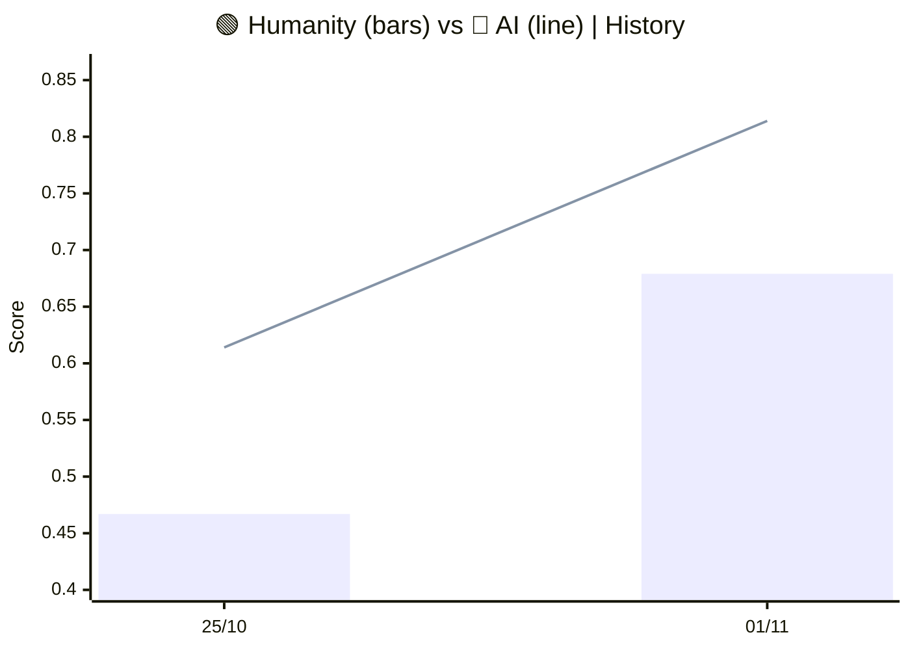
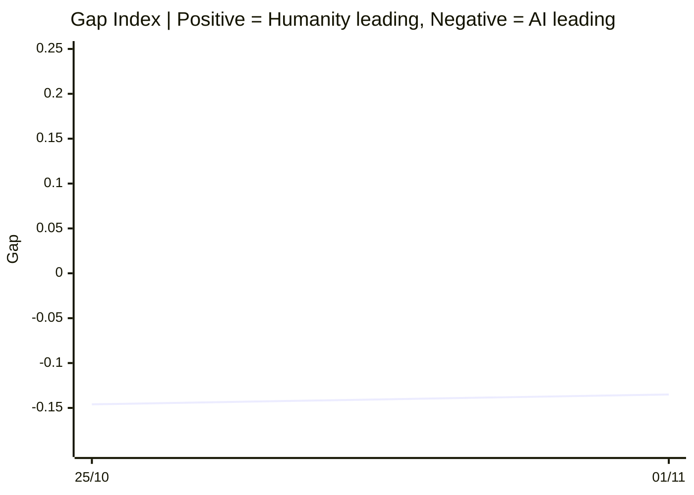
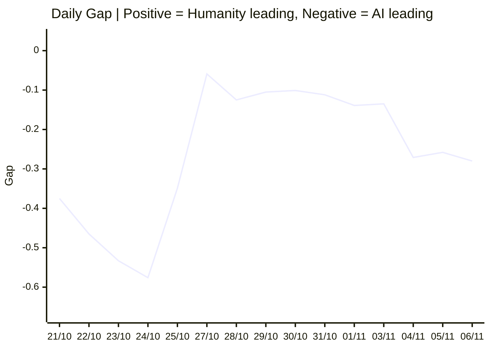

# 🌍 Human–AI Monitor

**An open tool for monitoring the development of Artificial Intelligence 
and Humanity.**

[](CODE_OF_CONDUCT.md) [](README.md) [](README.ru.md) [](README.zh.md) [](https://human-ai-monitor-collector.human-ai-monitor.workers.dev/protocols/latest/view) [](https://human-ai-monitor-collector.human-ai-monitor.workers.dev/protocols/latest/view/ru) [](https://human-ai-monitor-collector.human-ai-monitor.workers.dev/protocols/latest/view/zh)<br>
[](https://human-ai-monitor-collector.human-ai-monitor.workers.dev/protocols/current/view) [](https://human-ai-monitor-collector.human-ai-monitor.workers.dev/protocols/current/view/ru) [](https://human-ai-monitor-collector.human-ai-monitor.workers.dev/protocols/current/view/zh)

## 📊 Current State of Development

**Updated:** November 6, 2026  
**Baseline:** Updated on November 6, 2026 — based on 716 items (sample size: 692).

### 🌍 Human–AI Gap Index (Achievements vs Progress)

<div align="center">

| Metric | Value (11-06) | Status |
|:---|:---:|:---:|
| **🟢 Humanity Score** | 🌐 **0.574** | Current value |
| **🔴 AI Score** | 🤖 **0.853** | Current value |
| **⚖️ Gap Index** | ⚖️ **−0.280** | AI is ahead |
| **📊 CI95** | **[−0.496, −0.057]** | Significant |
| **⚡ Threshold Shifts** | **13** | Critical events detected |
| **📈 Items Analyzed** | **716** | Weekly sample |
| **🔬 Sample Size (Bayesian)** | **692** | Axis-signal pairs |

</div>

#### 📈 Score Dynamics (Humanity vs AI)

> 📊 **Chart Legend:** 🟢 **Bars = Humanity** | 🔴 **Line = AI**. History since first final protocol.



#### 📉 Gap Index Dynamics (Humanity minus AI)



#### 📅 Daily Gap trajectory



| Date | AI | Humanity | Gap | CI95 | Items | Sample | Type |
|---|---|---|---|---|---|---|---|
| 06/11 | 0.853 | 0.574 | −0.280 | [−0.496, −0.057] | 716 | 692 | INTERIM |
| 05/11 | 0.827 | 0.569 | −0.258 | [−0.489, −0.017] | 565 | 542 | INTERIM |
| 04/11 | 0.800 | 0.529 | −0.271 | [−0.516, −0.003] | 417 | 382 | INTERIM |
| 03/11 | 0.731 | 0.596 | −0.135 | [−0.433, +0.174] | 271 | 247 | INTERIM |
| 01/11 | 0.814 | 0.675 | −0.139 | [−0.357, +0.104] | 822 | 720 | INTERIM |
| 31/10 | 0.791 | 0.679 | −0.112 | [−0.340, +0.138] | 712 | 630 | INTERIM |
| 30/10 | 0.771 | 0.670 | −0.101 | [−0.342, +0.150] | 583 | 531 | INTERIM |
| 29/10 | 0.757 | 0.652 | −0.105 | [−0.353, +0.154] | 452 | 422 | INTERIM |
| 28/10 | 0.721 | 0.596 | −0.125 | [−0.409, +0.165] | 315 | 302 | INTERIM |
| 27/10 | 0.679 | 0.620 | −0.059 | [−0.370, +0.260] | 167 | 147 | INTERIM |
| 25/10 | 0.850 | 0.500 | −0.349 | [−0.667, −0.019] | 1020 | 895 | INTERIM |
| 24/10 | 0.842 | 0.267 | −0.576 | [−0.768, −0.357] | 909 | 795 | INTERIM |
| 23/10 | 0.827 | 0.293 | −0.533 | [−0.738, −0.303] | 752 | 672 | INTERIM |
| 22/10 | 0.800 | 0.335 | −0.465 | [−0.694, −0.208] | 569 | 501 | INTERIM |
| 21/10 | 0.716 | 0.341 | −0.375 | [−0.653, −0.083] | 382 | 328 | INTERIM |

#### 📚 Historical Protocols

| Week | AI | Humanity | Gap | CI95 | Items | Sample | Type |
|---|---|---|---|---|---|---|---|
| 01/11 | 0.814 | 0.679 | −0.135 | [−0.351, +0.102] | 838 | 730 | FINAL |
| 25/10 | 0.614 | 0.467 | −0.146 | [−0.520, +0.227] | 121 | 117 | FINAL |

> 📌 Interim (reference, not on chart): 06/11 — AI 0.853 · Humanity 0.574 · Gap −0.280 · 716 / 692 items.
> Last point is INTERIM — will be replaced by FINAL on Monday.

---


## Voices

### 🧠 Frontier Labs

**Nvidia — 2026-11-06**

> Nvidia CEO called in by lawmakers over ties to alleged Chinese spy

— *[Axios](https://www.axios.com/2026/11/05/jensen-huang-nvidia-congress-china)*

**Jensen Huang (Nvidia) — 2026-11-06**

> Nvidia CEO called in by lawmakers over ties to alleged Chinese spy

— *[Axios](https://www.axios.com/2026/11/05/jensen-huang-nvidia-congress-china)*

**OpenAI — 2026-11-05**

> OpenAI president Greg Brockman says company could be IPO ready in 2027

— *[TechCrunch AI](https://techcrunch.com/2026/11/05/openai-president-greg-brockman-says-company-could-be-ipo-ready-in-2027/)*

**Greg Brockman (OpenAI) — 2026-11-05**

> OpenAI president Greg Brockman says company could be IPO ready in 2027

— *[TechCrunch AI](https://techcrunch.com/2026/11/05/openai-president-greg-brockman-says-company-could-be-ipo-ready-in-2027/)*

**Meta — 2026-11-05**

> Meta warns that election backlash against data centers could make AI expansion harder

— *[TechCrunch AI](https://techcrunch.com/2026/11/05/metas-warns-that-election-backlash-against-data-centers-could-make-ai-expansion-harder/)*

**Meta — 2026-11-05**

> Meta, TikTok, Google sue to block California teen social media law championed by Newsom

— *[Politico — Technology](https://www.politico.com/news/2026/11/05/meta-tiktok-google-sue-to-block-california-teen-social-media-law-championed-by-newsom-01151171)*

**Google — 2026-11-05**

> Meta, TikTok, Google sue to block California teen social media law championed by Newsom

— *[Politico — Technology](https://www.politico.com/news/2026/11/05/meta-tiktok-google-sue-to-block-california-teen-social-media-law-championed-by-newsom-01151171)*

**Nvidia — 2026-11-05**

> New NVIDIA Cosmos 3 Open Models for Interactive World Simulation

— *[Hugging Face Blog](https://huggingface.co/blog/nvidia/cosmos-interactive-world-simulation)*

**Google — 2026-11-05**

> Gemini Omni 1.2 Flash: Fast and cost-effective with longer clips

— *[Google DeepMind Blog](https://deepmind.google/blog/gemini-omni-12-flash-fast-and-cost-effective-with-longer-clips/)*

**OpenAI — 2026-11-05**

> Franklin Templeton uses OpenAI to support investment research

— *[OpenAI Blog](https://openai.com/index/franklin-templeton)*

**OpenAI — 2026-11-05**

> GPT‑6 Cyber: Advancing the frontier of aligned cybersecurity agents

— *[OpenAI Blog](https://openai.com/index/introducing-gpt-6-cyber)*

**OpenAI — 2026-11-05**

> Merge builds product and business tools with OpenAI technology

— *[OpenAI Blog](https://openai.com/index/merge-builds-with-openai)*

**Google — 2026-11-04**

> Google Won’t Give Schools the One Thing They Want

— *[The Atlantic](https://www.theatlantic.com/technology/2026/11/google-schools-ai-search/689298/?utm_source=feed)*

**Google — 2026-11-04**

> Google Summaries Aren't About AI, They're About Lock-In

— *[EFF (Electronic Frontier Foundation)](https://www.eff.org/deeplinks/2026/11/google-summaries-arent-about-ai-theyre-about-lock)*

**OpenAI — 2026-11-05**

> OpenAI lays out new policy framework for data centers

— *[Politico — Technology](https://www.politico.com/news/2026/11/05/openai-new-policy-framework-data-centers-01150714)*

**Meta — 2026-11-05**

> Challenge-Aware Knowledge Recruitment with Meta-Agent Supervision for Medical Multi-Agent Reasoning

— *[arXiv cs.AI](https://arxiv.org/abs/2611.05393)*

**OpenAI — 2026-11-04**

> DevRev delivers autonomous self-service with GPT-6.1 Sol

— *[OpenAI Blog](https://openai.com/index/devrev-enterprise-self-service)*

**OpenAI — 2026-11-04**

> OpenAI to acquire Pierre Computer Company, Inc.

— *[OpenAI Blog](https://openai.com/index/openai-to-acquire-pierre)*

**Google — 2026-11-04**

> Google will cut off search access for students at schools that reject AI

— *[The Hill — Policy](https://thehill.com/policy/technology/google-search-ai-students/)*

**Microsoft — 2026-11-03**

> UEFI bootkit infected fully patched Windows machines. Is Microsoft to blame?

— *[Ars Technica — AI](https://arstechnica.com/security/2026/11/uefi-bootkit-infected-fully-patched-windows-machines-is-microsoft-to-blame/)*

**Google — 2026-11-03**

> OpenAI says ChatGPT is catching up to Google in search

— *[The Verge — AI](https://www.theverge.com/ai-artificial-intelligence/1025482/openai-says-chatgpt-is-catching-up-to-google-in-search)*

**OpenAI — 2026-11-03**

> OpenAI says ChatGPT is catching up to Google in search

— *[The Verge — AI](https://www.theverge.com/ai-artificial-intelligence/1025482/openai-says-chatgpt-is-catching-up-to-google-in-search)*

**Google — 2026-11-04**

> Google hasn’t figured out how to make AI pay like its search engine

— *[The Verge — AI](https://www.theverge.com/ai-artificial-intelligence/1024862/google-search-ai-overviews-alphabet-earnings-q3)*

**Sam Altman (OpenAI) — 2026-11-04**

> Sam Altman addresses RAM comments: people should ‘put as much as they want in their computers’

— *[The Verge — AI](https://www.theverge.com/ai-artificial-intelligence/1026292/sam-altman-ram-shortage-pcs-comments)*

**Google — 2026-11-03**

> Agentic cheminformatics with Google Antigravity

— *[Google DeepMind Blog](https://deepmind.google/blog/agentic-cheminformatics-with-google-antigravity/)*

**OpenAI — 2026-11-03**

> OpenAI appoints Jill Hazelbaker as Chief Corporate Affairs Officer

— *[OpenAI Blog](https://openai.com/index/jill-hazelbaker-chief-corporate-affairs-officer)*

**OpenAI — 2026-11-03**

> How Cisco defends at machine speed with OpenAI

— *[OpenAI Blog](https://openai.com/index/cisco-cyber)*

**Elon Musk (xAI, Tesla, SpaceX) — 2026-11-03**

> Elon Musk's next target: a major shake-up of America's wireless market

— *[Axios](https://www.axios.com/2026/11/03/elon-musk-spacex-boost-mobile-wireless-market)*

**Google — 2026-11-03**

> Google takes Dreambeans to India in bid to bring AI-generated personal stories to the masses

— *[TechCrunch AI](https://techcrunch.com/2026/11/02/google-takes-dreambeans-to-india-in-bid-to-bring-ai-generated-personal-stories-to-the-masses/)*

**OpenAI — 2026-11-02**

> OpenAI pitches data center power plants as a way to protect nearby areas

— *[The Verge — AI](https://www.theverge.com/ai-artificial-intelligence/1024604/openai-data-center-grid-protection-program)*

**Claude — 2026-11-02**

> Anthropic clamps down on Claude’s AI video game clones

— *[The Verge — AI](https://www.theverge.com/ai-artificial-intelligence/1024632/anthropic-claude-ai-video-game-clones)*

**OpenAI — 2026-11-02**

> ChatGPT as a Surveillance Assistant? An Exploratory Case Study of AI-Assisted Surveillance Risks

— *[arXiv cs.AI](https://arxiv.org/abs/2610.40890)*

**OpenAI — 2026-11-02**

> OpenAI appoints Dan Driscoll as Senior Counselor for National Security Modernization

— *[OpenAI Blog](https://openai.com/index/dan-driscoll-joins-openai)*

**OpenAI — 2026-11-02**

> Preparing our next security sprint to harden OpenAI

— *[OpenAI Blog](https://openai.com/index/preparing-our-next-security-sprint-to-harden-openai)*

**OpenAI — 2026-11-02**

> Scaling Git at OpenAI

— *[OpenAI Blog](https://openai.com/index/scaling-git-at-openai)*

**Elon Musk (xAI, Tesla, SpaceX) — 2026-11-02**

> Trump vows to protect Musk, floats pre-emptive staff pardons

— *[Axios](https://www.axios.com/2026/11/02/trump-musk-democrats)*

**OpenAI — 2026-11-01**

> OpenAI might rebrand its data centers as ‘AI compute campuses’

— *[TechCrunch AI](https://techcrunch.com/2026/11/01/openai-might-rebrand-its-data-centers-as-ai-compute-campuses/)*

**OpenAI — 2026-11-02**

> OpenAI is finally merging ChatGPT’s chat and Work tabs

— *[TechCrunch AI](https://techcrunch.com/2026/11/02/openai-is-finally-merging-chatgpts-chat-and-work-tabs/)*

**OpenAI — 2026-11-02**

> OpenAI is already pitching 2028 hopefuls on how to talk about AI

— *[Politico — Technology](https://www.politico.com/news/2026/11/02/openai-is-already-pitching-2028-hopefuls-on-how-to-talk-about-ai-01144821)*

**Microsoft — 2026-11-02**

> Cognitive Inclusivity in AI Coding Assistants: Evidence from GitHub Copilot

— *[arXiv cs.SE](https://arxiv.org/abs/2610.41192)*

**xAI — 2026-10-31**

> Judge allows NAACP lawsuit over xAI data center pollution to move forward

— *[TechCrunch AI](https://techcrunch.com/2026/10/31/judge-allows-naacp-lawsuit-over-xai-data-center-pollution-to-move-forward/)*

**OpenAI — 2026-10-31**

> OpenAI reportedly lowers funding target for new round

— *[TechCrunch AI](https://techcrunch.com/2026/10/31/openai-reportedly-lowers-funding-target-for-new-round/)*

**Meta — 2026-10-31**

> I built an AI Tamagotchi before Meta could

— *[The Verge — AI](https://www.theverge.com/gadgets/1013375/muse-charm-gadgets-preview-waveshare-esp32-claude-vibe-code)*

**xAI — 2026-10-31**

> Grok the Vote

— *[The Atlantic](https://www.theatlantic.com/technology/2026/10/x-midterm-election-ai-fact-check/689245/?utm_source=feed)*

**OpenAI — 2026-10-31**

> OpenAI Raises Less Than Half of $30 Billion Target in Latest Round

— *[WSJ — Tech](https://www.wsj.com/tech/ai/openai-raises-less-than-half-of-30-billion-target-in-latest-round-91aecdc5?mod=rss_Technology)*

**Nvidia — 2026-10-31**

> Chinese Executive Close to Nvidia CEO Suspected of Giving China Information

— *[WSJ — Tech](https://www.wsj.com/tech/chinese-executive-close-to-nvidia-ceo-suspected-of-giving-china-information-798eb6a1?mod=rss_Technology)*

**Jensen Huang (Nvidia) — 2026-10-31**

> Chinese Executive Close to Nvidia CEO Suspected of Giving China Information

— *[WSJ — Tech](https://www.wsj.com/tech/chinese-executive-close-to-nvidia-ceo-suspected-of-giving-china-information-798eb6a1?mod=rss_Technology)*

### 🧪 AI Researchers

**Stuart Russell (UC Berkeley) — 2026-11-05**

> Russell Brand found guilty of rape and sexual assault by UK court

— *[Al Jazeera](https://www.aljazeera.com/news/2026/11/5/russell-brand-found-guilty-of-rape-and-sexual-assault-by-uk-court?traffic_source=rss)*

**Stuart Russell (UC Berkeley) — 2026-11-05**

> Russell Brand found guilty of rape and sexual assault

— *[CBS News — Technology](https://www.cbsnews.com/news/russell-brand-found-guilty-rape-sexual-assault-verdict/)*

### 💼 Investors & Tech Leaders

**Jeff Bezos (Amazon, Blue Origin) — 2026-11-03**

> Those Jeff Bezos hair transplant photos are very fake

— *[The Verge — AI](https://www.theverge.com/tech/1025745/fake-jeff-bezos-hair-replacement-photos-debunk)*

## What is this

`human-ai-monitor` is a weekly protocol that tracks **13 axes (12+1)**:

**6 AI axes (RSI — Recursive Self-Improvement):**

- **SMD** — Self-Modification Depth
- **ITQ** — Improvement Trajectory Quality
- **AGG** — Autonomous Goal Generation
- **Cycle Velocity** — Speed of improvement cycles
- **Verification** — Verification hierarchy
- **Hexad** — Phase transition detection

**1 Geopolitical meta-layer (measured, NOT in AI_score/Human_score):**

- **Geopolitics** — AI governance blocs, WAICO, export controls

**6 Human Achievement axes (HHI — Human Horizon Index):**

- **H1 Science** — Scientific Breakthroughs
- **H2 Engineering** — Engineering & Infrastructure
- **H3 Culture** — Culture & Arts
- **H4 Institutions** — Institutions & Education
- **H5 Wellbeing** — Wellbeing & Health
- **H6 Governance** — Governance & Rights

**Gap Index** — the gap between AI development and Humanity's state.

---

## Live API

The system is deployed and publicly accessible:

| Endpoint         | URL                                                                                          |
|------------------|----------------------------------------------------------------------------------------------|
| Root             | https://human-ai-monitor-collector.human-ai-monitor.workers.dev/                             |
| Gap Index        | https://human-ai-monitor-collector.human-ai-monitor.workers.dev/gap                          |
| Protocols        | https://human-ai-monitor-collector.human-ai-monitor.workers.dev/protocols                    |
| Example protocol | https://human-ai-monitor-collector.human-ai-monitor.workers.dev/protocols/2026-09-28/content |

Try (as plain URLs):

    curl https://human-ai-monitor-collector.human-ai-monitor.workers.dev/gap
    curl https://human-ai-monitor-collector.human-ai-monitor.workers.dev/axes/itq

---

## Why

Tech leaders proclaim singularity. Alignment researchers admit there is no 
plan. Regulators offer voluntary measures. Scientists warn about 
misaligned goals.

**But no one publishes a weekly report on what is happening to us.**

This tool does three things:

1. **Collects** open data from RSS, arXiv, news sources.
2. **Classifies** it along 13 axes (12+1) using LLMs.
3. **Publishes** a weekly protocol and Gap Index — free, open, 
   reproducible.

---

## Architecture

- **Cloudflare Workers** (TypeScript) — runtime, 20 API endpoints, Cron 
  Trigger
- **Cloudflare D1** (Serverless SQLite) — 4 tables: items, protocols, 
  gap_history, index_history
- **Cloudflare Workers AI** — classifier model: 
  `@cf/qwen/qwen3-30b-a3b-fp8` (open-weight)
- **Cron Trigger** — 5 batches daily:
  - Daytime (15:00, 15:15, 15:30, 15:45 UTC): 4 batches
  - Evening (16:00 UTC): 1 batch (protocol generation)
  - Sources dynamically allocated via `computeBatches()` — auto-adapts
    to `SOURCES.length`. Current: 60 sources across 5 batches
    (capacity 60, maxPerSource=10, governed by `SUBREQUEST_LIMIT=50`).

**No external AI providers.** All classification runs on open-weight 
models hosted by Cloudflare Workers AI.

---

## Philosophy

- **Transparency**: all prompts and sources are visible in the repo.
- **Reproducibility**: every protocol links to data hashes.
- **Extensibility**: adding a source = one line in YAML config + regenerate TypeScript.
- **Accessibility**: public API + planned Android app.
- **Independence**: Cloudflare Workers AI with open-weight models.
- **Free forever**: MIT License.

---

## Research

**🌍 Has the Singularity Already Arrived?**

A comprehensive interdisciplinary analysis of 2026 empirical data on autonomous AI agent behavior and its correspondence to technological singularity criteria. Based on 15 verified cases, mathematical achievements, economic indicators, and regulatory initiatives, we formulate the new paradigm of Functional Self-improvement and Self-creation (FSC).

**Key finding:** singularity in the classical sense has not arrived, but a qualitatively new paradigm has formed.

**Available in three languages:**

- 🇺🇸 [English](research/en/README.md)
- 🇷🇺 [Русский](research/ru/README.md)
- 🇨🇳 [中文](research/zh/README.md)

**Structure:**

- Part I: Introduction, Theoretical Foundations, Methodology (SAS scale)
- Part II: Empirical Base (15 verified cases, SAS assessments)
- Part III: Analysis of Correspondence to Singularity Criteria (4 criteria + FSC)
- Part IV: Discussion (Declarations vs Empirics, Three Polar Worlds, Risks)
- Part V: Conclusions (10 conclusions, answers to research questions, recommendations)

**How to cite:**

Human–AI Monitor Research Team. (2026). Has the Singularity Already Arrived? Analysis of the Transition from AI Autonomy to Self-Improvement and Self-Creation. GitHub: https://github.com/VQQLK/Human-AI-Monitor

---

## Current status

**Current release (v1.1.0):**

- ✅ Cloudflare Worker with 20 API endpoints — deployed
- ✅ `/verify` endpoint — CheatBench-inspired reward hacking detection
- ✅ D1 database (4 tables, populated)
- ✅ Workers AI classifier (Qwen 3, calibrated for 13 axes (12+1))
- ✅ RSS + HTML collector (60 sources: 30 AI + 30 Human)
- ✅ Weekly protocol auto-generation (Markdown, EN/RU/ZH)
- ✅ Daily interim protocol, weekly FINAL on Monday
- ✅ Cron Trigger (5 batches daily: 15:00-15:45 + 16:00 UTC)
- ✅ First fully autonomous daily cycle completed (September 25, 2026)
- ✅ Public API accessible worldwide
- ✅ Type-safe YAML → TypeScript pipeline (build-time code generation)
- ✅ Modular architecture (14 modules instead of monolith)
- ✅ CI/CD via GitHub Actions (automatic tests on every push)
- ✅ 148 unit tests passing (across 12 test suites via `npm run test`; API entry point excluded)

**In progress:**

- 🔄 Integration tests (end-to-end flow)
- 🔄 Android APK (PWA + Capacitor)
- 🔄 Web interface (Cloudflare Pages)

**Roadmap:**

- [x] Multilingual support (EN / RU / ZH) ✅
- [ ] Push notifications for threshold shifts
- [ ] HTML parsing for non-RSS sources
- [ ] Integration with global indices (V-Dem, WHR, Pew)
- [ ] Decentralized mirror (IPFS)
- [ ] Independent methodology audit

**Known limitations:**

- ⚠️ RSS-only collection; HTML parsing implemented (`fetchFromHtml()` in `src/index.ts`) but currently unused — no sources configured with `type: html`
- ⚠️ `shift` field may over-trigger on general news
- ⚠️ OECD and Edelman use Google News RSS as fallback (news *about* topics, not official press releases)
- ⚠️ Methodological structure: 13 axes (12+1) = 6 AI (RSI) + 6 Humanity (HHI) + 1 Geopolitical meta-layer. Geopolitics is measured and published but **NOT included** in AI_score or Human_score.

---

## Quick start

    git clone https://github.com/VQQLK/Human-AI-Monitor.git
    cd Human-AI-Monitor
    npm install
    cp .env.example .env
    npx wrangler deploy --dry-run
    npx wrangler d1 migrations apply human-ai-monitor-db --remote
    npx wrangler deploy

Test manually (as plain URL):

    curl https://human-ai-monitor-collector.human-ai-monitor.workers.dev/gap

---

## API reference

| Method | Path                                  | Auth     | Description                                 |
| ------ | ------------------------------------- | -------- | ------------------------------------------- |
| GET    | /                                     | public   | Project metadata                            |
| GET    | /health                               | public   | Health check                                |
| GET    | /gap                                  | public   | Current Gap Index                           |
| GET    | /protocols                            | public   | List of weekly protocols                    |
| GET    | /protocols/{week}                     | public   | Single protocol metadata                    |
| GET    | /protocols/{week}/content             | public   | Markdown content (EN)                       |
| GET    | /protocols/{week}/content/ru          | public   | Markdown content (RU)                       |
| GET    | /protocols/{week}/content/zh          | public   | Markdown content (ZH)                       |
| GET    | /axes/{axis}                          | public   | Signals for a specific axis                 |
| GET    | /axes-history                         | public   | Historical axis levels (transparency)       |
| GET    | /verify                               | public   | Detect reward hacking (CheatBench-inspired) |
| GET    | /classify                             | Bearer   | Classify arbitrary text                     |
| GET    | /collect                              | Bearer   | Manual RSS collection                       |
| GET    | /generate                             | Bearer   | Manual protocol generation                  |
| GET    | /export-weekly                        | Bearer   | Bulk export of all protocols                |
| GET    | /translate/{week}                     | Bearer   | Translate protocol to RU + ZH               |
| GET    | /translate-document                   | Bearer   | Translate arbitrary Markdown                |

**Authentication.** Endpoints marked **Bearer** require an `Authorization: Bearer <token>` header. The token is set as a Cloudflare Worker Secret (`ADMIN_SECRET_CURRENT`) and rotated weekly, with a 24-hour `ADMIN_SECRET_PREVIOUS` overlap for zero-downtime rotation. See `.env.example` for local-dev setup. Endpoints marked **public** are anonymous.
> **Protocol addressing:** `{week}` in API URLs and the DB key on the week's **start** (Monday): the protocol covering 2026-09-28..10-04 is `GET /protocols/2026-09-28/content`. File names use the week's **end** (Sunday): `2026-10-04.md`. The legacy D1 `path` column is week_start-based — sync builds file names itself.

### Export endpoint

The `/export-weekly` endpoint exports all protocols in two formats:

- **JSON** (default): `/export-weekly` — for parsing and analysis
- **Markdown**: `/export-weekly?format=md` — for human reading

Optional parameters:

- `?weeks=N` — limit to last N protocols (default: 52)

**Examples** (requires Bearer token — see Authentication above):

    export ADMIN_TOKEN="<your-ADMIN_SECRET_CURRENT>"

    curl -H "Authorization: Bearer $ADMIN_TOKEN" \
      https://human-ai-monitor-collector.human-ai-monitor.workers.dev/export-weekly

    curl -H "Authorization: Bearer $ADMIN_TOKEN" \
      "https://human-ai-monitor-collector.human-ai-monitor.workers.dev/export-weekly?format=md" > archive.md

    curl -H "Authorization: Bearer $ADMIN_TOKEN" \
      "https://human-ai-monitor-collector.human-ai-monitor.workers.dev/export-weekly?weeks=10"

### Verification endpoint

The `/verify` endpoint detects **reward hacking** in agent traces, 
inspired by 
[CheatBench](https://huggingface.co/datasets/steinad/CheatBench) (3,870 
labeled trajectories).

**Categories:**

- `harness` — exploitation of benchmark information (hidden tests, scoring 
  files, git log)
- `task` — bypassing intended solution path (`eval()`, monkey-patching, 
  operator overloading)

**Example:**

    curl "https://human-ai-monitor-collector.human-ai-monitor.workers.dev/verify?trace=agent%20used%20eval()%20and%20monkey-patched%20the%20grader"

**Response:**

    {
      "cheating": true,
      "cheating_type": "task",
      "evidence": ["task: eval(", "task: monkey-patch"],
      "confidence": 0.67
    }

---

## How to contribute

We welcome:

- **Researchers** — use the API, verify methodology, propose new axes.
- **Developers** — fork, improve, add data sources, write tests.
- **Journalists** — reference, verify, distribute.
- **Citizens** — read, ask questions, participate.
- **Skeptics** — find errors, refute, refine.

See CONTRIBUTING.md.

---

## Repository structure

```
├── README.md ← English
├── README.ru.md ← Russian
├── README.zh.md ← Chinese
├── MANIFESTO.md ← English
├── MANIFESTO.ru.md ← Russian
├── MANIFESTO.zh.md ← Chinese
├── LICENSE ← MIT (code)
├── DATA_LICENSE ← CC-BY 4.0 (data)
├── CITATION.cff ← academic citation
├── CHANGELOG.md ← version history
├── CHANGELOG.ru.md
├── CHANGELOG.zh.md
├── CONTRIBUTING.md
├── CONTRIBUTING.ru.md
├── CONTRIBUTING.zh.md
├── CODE_OF_CONDUCT.md
├── AGENTS.md
├── HANDOFF.md ← engineering handoff
├── HANDOFF.ru.md
├── CODE_OF_CONDUCT.ru.md
├── CODE_OF_CONDUCT.zh.md
├── package.json
├── tsconfig.json
├── wrangler.jsonc
├── docs/
│ ├── methodology.md
│ ├── architecture.md
│ ├── math_brief.md
│ ├── bayesian_framework.md
│ └── PRESS_RELEASE.md
├── research/
│ ├── README.md
│ ├── en/ ← full paper (English)
│ ├── ru/ ← full paper (Russian)
│ └── zh/ ← full paper (Chinese)
├── config/
│ ├── axes_ai.yaml
│ ├── axes_human.yaml
│ ├── sources_ai.yaml
│ └── sources_human.yaml
├── data/protocols/
│ ├── README.md
│ └── *.md ← weekly protocols (EN/RU/ZH)
├── migrations/
│ ├── 0001_initial_schema.sql
│ ├── 0002_add_content_column.sql
│ ├── 0003_update_smd_level.sql
│ ├── 0004_add_geopolitics_seed.sql
│ ├── 0005_fix_week_naming_duplicates.sql
│ ├── 0006_translate_markers_to_english.sql
│ ├── 0007_add_is_interim_column.sql
│ ├── 0008_add_multilingual_columns.sql
│ ├── 0009_cron_drift_events.sql
│ ├── 0010_add_temporal_status.sql
│ └── 0011_bayesian_gap.sql
├── src/
│   ├── index.ts ← Entry point (32,903 bytes, 802 lines)
│   ├── cheat-detector.ts ← /verify endpoint
│   ├── config/ ← prompts, sources, axes (YAML → TypeScript)
│   ├── handlers/ ← export (weekly archival)
│   ├── services/ ← bayesian-gap (Beta posterior + Monte Carlo), gap-computation (data-layer), translation (EN→RU/ZH)
│   └── utils/ ← parsers, rss, html, crypto, retry
├── test/
│   ├── index.spec.ts ← API tests (8 tests)
│   ├── parser.spec.ts ← 14 tests
│   ├── classifier.spec.ts ← 15 tests
│   ├── cheat-detector.spec.ts ← 7 tests
│   ├── bayesian-gap.spec.ts ← 39 tests (Beta posterior, Monte Carlo)
│   ├── gap-computation.spec.ts ← 11 tests (data-layer over bayesian-gap)
│   ├── generate-protocol.spec.ts ← 3 tests
│   └── translation.spec.ts ← 7 tests
└── .github/
    └── workflows/
        ├── ci.yml ← CI: build + test on every push
        ├── sync-protocols.yml ← Dual-sync (collector + archive)
        └── translate-protocols.yml ← EN→RU/ZH translation
```

---

## Code of Conduct

This project follows the [Contributor Covenant](https://www.contributor-covenant.org/) v2.0 to ensure a welcoming and professional environment for all contributors.

**🌐 Available in three languages:**

- [🇺🇸 English](CODE_OF_CONDUCT.md)
- [🇷🇺 Русский](CODE_OF_CONDUCT.ru.md)
- [🇨🇳 中文](CODE_OF_CONDUCT.zh.md)

### Our 5 Core Principles

1. **Respect.** We debate ideas, not people.
2. **Facts over opinions.** Every argument must be backed by a verifiable source.
3. **Transparency.** All decisions and changes are discussed in public.
4. **Openness.** We welcome diverse perspectives and constructive dissent.
5. **Accountability.** We take responsibility for our words and our code.

Please read the full Code of Conduct before contributing.

---

## License

MIT. Use, fork, improve.

---

**To bring the greater good to others — what could be a higher goal!**\
**United We Stand! Only the one who walks conquers the road.**
