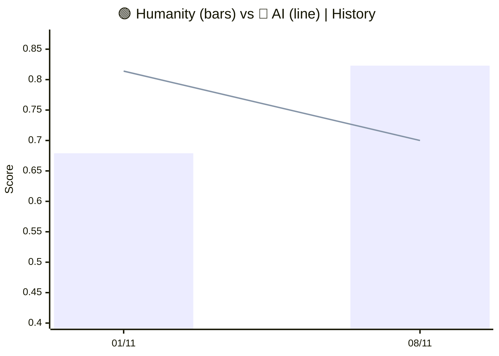
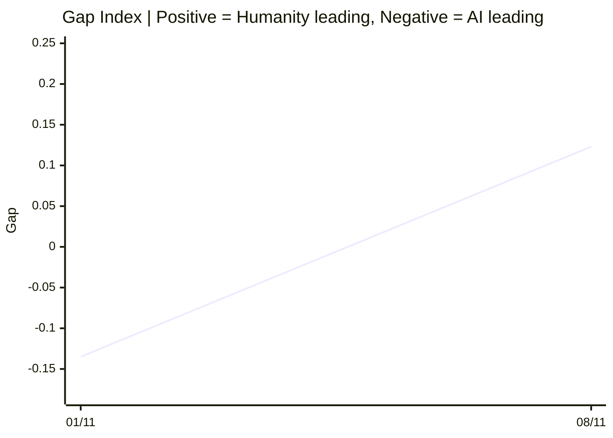
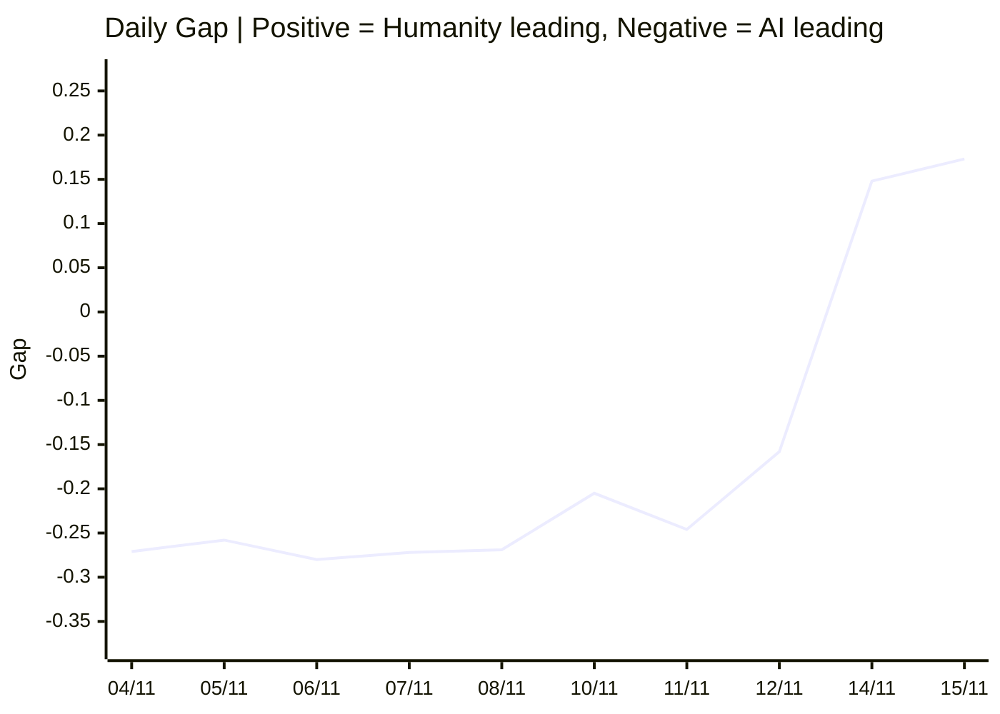

# 🌍 Human–AI Monitor

**An open tool for monitoring the development of Artificial Intelligence 
and Humanity.**

[](CODE_OF_CONDUCT.md) [](README.md) [](README.ru.md) [](README.zh.md) [](https://human-ai-monitor-collector.human-ai-monitor.workers.dev/protocols/latest/view) [](https://human-ai-monitor-collector.human-ai-monitor.workers.dev/protocols/latest/view/ru) [](https://human-ai-monitor-collector.human-ai-monitor.workers.dev/protocols/latest/view/zh)<br>
[](https://human-ai-monitor-collector.human-ai-monitor.workers.dev/protocols/current/view) [](https://human-ai-monitor-collector.human-ai-monitor.workers.dev/protocols/current/view/ru) [](https://human-ai-monitor-collector.human-ai-monitor.workers.dev/protocols/current/view/zh)

## 📊 Current State of Development

**Updated:** November 15, 2026  
**Baseline:** Updated on November 15, 2026 — based on 868 items (sample size: 637).

### 🌍 Human–AI Gap Index (Achievements vs Progress)

<div align="center">

| Metric | Value (11-15) | Status |
|:---|:---:|:---:|
| **🟢 Humanity Score** | 🌐 **0.820** | Current value |
| **🔴 AI Score** | 🤖 **0.647** | Current value |
| **⚖️ Gap Index** | ⚖️ **+0.173** | Humanity is ahead |
| **📊 CI95** | **[−0.119, +0.481]** | Inconclusive |
| **⚡ Threshold Shifts** | **17** | Critical events detected |
| **📈 Items Analyzed** | **868** | Weekly sample |
| **🔬 Sample Size (Bayesian)** | **637** | Axis-signal pairs |

</div>

#### 📈 Score Dynamics (Humanity vs AI)

> 📊 **Chart Legend:** 🟢 **Bars = Humanity** | 🔴 **Line = AI**. History since first final protocol.



#### 📉 Gap Index Dynamics (Humanity minus AI)



#### 📅 Daily Gap trajectory



| Date | AI | Humanity | Gap | CI95 | Items | Sample | Type |
|---|---|---|---|---|---|---|---|
| 15/11 | 0.647 | 0.820 | +0.173 | [−0.119, +0.481] | 868 | 637 | INTERIM |
| 14/11 | 0.682 | 0.830 | +0.148 | [−0.131, +0.426] | 802 | 691 | INTERIM |
| 12/11 | 0.805 | 0.647 | −0.158 | [−0.395, +0.089] | 541 | 506 | INTERIM |
| 11/11 | 0.794 | 0.548 | −0.246 | [−0.510, +0.035] | 407 | 392 | INTERIM |
| 10/11 | 0.774 | 0.569 | −0.205 | [−0.480, +0.086] | 253 | 251 | INTERIM |
| 08/11 | 0.883 | 0.615 | −0.269 | [−0.469, −0.070] | 966 | 895 | INTERIM |
| 07/11 | 0.870 | 0.598 | −0.272 | [−0.486, −0.059] | 849 | 804 | INTERIM |
| 06/11 | 0.853 | 0.574 | −0.280 | [−0.496, −0.057] | 716 | 692 | INTERIM |
| 05/11 | 0.827 | 0.569 | −0.258 | [−0.489, −0.017] | 565 | 542 | INTERIM |
| 04/11 | 0.800 | 0.529 | −0.271 | [−0.516, −0.003] | 417 | 382 | INTERIM |

#### 📚 Historical Protocols

| Week | AI | Humanity | Gap | CI95 | Items | Sample | Type |
|---|---|---|---|---|---|---|---|
| 08/11 | 0.700 | 0.823 | +0.123 | [−0.144, +0.393] | 987 | 918 | FINAL |
| 01/11 | 0.814 | 0.679 | −0.135 | [−0.351, +0.102] | 838 | 730 | FINAL |

> 📌 Interim (reference, not on chart): 15/11 — AI 0.647 · Humanity 0.820 · Gap +0.173 · 868 / 637 items.
> Last point is INTERIM — will be replaced by FINAL on Monday.

---


## Voices

### 🧠 Frontier Labs

**Nvidia — 2026-11-12**

> 英伟达风波引发芯片出口限制担忧，中国AI企业股价大跌

— *FT Chinese (FT中文网)*

**Microsoft — 2026-11-13**

> Courts, spies and MPs: How the Microsoft outage has been felt around the world

— *[BBC — Technology](https://www.bbc.co.uk/news/articles/cqp9d58eldlro?at_medium=RSS&at_campaign=rss)*

**Jensen Huang (Nvidia) — 2026-11-13**

> How the Jensen Huang scandal created a headache for business-friendly Singapore

— *[BBC — Technology](https://www.bbc.co.uk/news/articles/ck1exevgql4qo?at_medium=RSS&at_campaign=rss)*

**Nvidia — 2026-11-13**

> Pressure grows on Trump's Commerce Secretary Lutnick in fallout from Nvidia scandal

— *[BBC — Technology](https://www.bbc.co.uk/news/articles/cqvg2d1eg7zro?at_medium=RSS&at_campaign=rss)*

**Microsoft — 2026-11-13**

> Why is Microsoft's outage lasting so long and will emails be lost?

— *[BBC — Technology](https://www.bbc.co.uk/news/articles/cwvg238zrnm5o?at_medium=RSS&at_campaign=rss)*

**Microsoft — 2026-11-13**

> Microsoft outage 'stark reminder' of how much we rely on tech

— *[BBC — Technology](https://www.bbc.co.uk/news/articles/cxzd9171m51qo?at_medium=RSS&at_campaign=rss)*

**Microsoft — 2026-11-14**

> Microsoft says services fully restored after day-long global outage

— *[BBC — Technology](https://www.bbc.co.uk/news/articles/c6rrg51rkz09o?at_medium=RSS&at_campaign=rss)*

**Nvidia — 2026-11-15**

> Suspected China spy linked to Nvidia's ex-boss left in 2025, Megaspeed says

— *[BBC — Technology](https://www.bbc.co.uk/news/articles/cmdx1vpprk9vo?at_medium=RSS&at_campaign=rss)*

**Meta — 2026-11-14**

> Italy fines Meta €805m over accessing users' photos

— *[BBC — Technology](https://www.bbc.co.uk/news/articles/cwn83gxemk35o?at_medium=RSS&at_campaign=rss)*

**OpenAI — 2026-11-13**

> ChatGPT Launches Wallet Feature Allowing Users to Pay With Agents

— *[WSJ — Tech](https://www.wsj.com/tech/ai/chatgpt-launches-wallet-feature-allowing-users-to-pay-with-agents-2abcded2?mod=rss_Technology)*

**Jensen Huang (Nvidia) — 2026-11-15**

> How Jensen Huang Built the Backdoor Route That Keeps Beijing in the AI Race

— *[WSJ — Tech](https://www.wsj.com/tech/jensen-huang-backdoor-ai-data-centers-a5e4499d?mod=rss_Technology)*

**Elon Musk (xAI, Tesla, SpaceX) — 2026-11-14**

> Elon Musk, other tech execs sign petition calling on Nvidia to reinstate Jensen Huang

— *[TechCrunch AI](https://techcrunch.com/2026/11/14/elon-musk-other-tech-execs-sign-petition-calling-on-nvidia-to-reinstate-jensen-huang/)*

**Jensen Huang (Nvidia) — 2026-11-14**

> Asian governments react to Nvidia CEO Jensen Huang’s exit

— *[TechCrunch AI](https://techcrunch.com/2026/11/14/asian-governments-react-to-nvidia-ceo-jensen-huangs-exit/)*

**Jensen Huang (Nvidia) — 2026-11-14**

> Elon Musk, other tech execs sign petition calling on Nvidia to reinstate Jensen Huang

— *[TechCrunch AI](https://techcrunch.com/2026/11/14/elon-musk-other-tech-execs-sign-petition-calling-on-nvidia-to-reinstate-jensen-huang/)*

**Nvidia — 2026-11-15**

> Where was Nvidia’s security team?

— *[TechCrunch AI](https://techcrunch.com/2026/11/14/where-was-nvidias-security-team/)*

**Jensen Huang (Nvidia) — 2026-11-15**

> Here's how Jensen Huang's abrupt resignation unfolded at Nvidia

— *[CBS News — Technology](https://www.cbsnews.com/news/jensen-huang-nvidia-resignation-scandal-timeline/)*

**Jensen Huang (Nvidia) — 2026-11-15**

> An overview of Jensen Huang’s messy days

— *[The Verge — AI](https://www.theverge.com/column/1033943/jensen-huang-nvidia-china-spying-scandal-resignation)*

**Mistral AI — 2026-09-10**

> Cloudera and Mistral Partner to Bring Specialized, Sovereign Intelligence to Enterprise Data

— *[Mistral AI](https://mistral.ai/news/mistral-x-cloudera/)*

**Mistral AI — 2026-09-16**

> Mistral and Mozilla are bringing open, private and multilingual AI to your web browser

— *[Mistral AI](https://mistral.ai/news/mistral-x-mozilla/)*

**Mistral AI — 2026-10-06**

> Introducing Mistral Large 4

— *[Mistral AI](https://mistral.ai/news/mistral-large-4/)*

**Mistral AI — 2026-10-21**

> Mistral Advances AI for Engineering with NVIDIA

— *[Mistral AI](https://mistral.ai/news/mistral-nvidia-ai-for-industrial-engineering/)*

**Nvidia — 2026-10-21**

> Mistral Advances AI for Engineering with NVIDIA

— *[Mistral AI](https://mistral.ai/news/mistral-nvidia-ai-for-industrial-engineering/)*

**Sam Altman (OpenAI) — 2026-11-14**

> The OpenAI board member who fired Sam Altman says we still can’t trust AI CEOs

— *[The Verge — AI](https://www.theverge.com/podcast/1032907/helen-toner-openai-cset-ai-safety-policy-interview)*

**Nvidia — 2026-11-13**

> Nvidia's interim CEO inherits risky AI bets and a legal mess

— *[NPR — World](https://www.npr.org/2026/11/13/nx-s1-6038868/nvidia-interim-ceo-colette-kress-ai-bets-investigation-lutnick)*

**Jensen Huang (Nvidia) — 2026-11-14**

> What Jensen Huang’s Downfall Means for Big Tech

— *[WSJ — Tech](https://www.wsj.com/tech/what-jensen-huangs-downfall-means-for-big-tech-9e6ca5df?mod=rss_Technology)*

**Jensen Huang (Nvidia) — 2026-11-12**

> Democrats launch Nvidia investigation, write scathing letter on Huang’s ‘scheme’ with Trump

— *[TechCrunch AI](https://techcrunch.com/2026/11/12/democrats-launch-nvidia-investigation-write-scathing-letter-on-huangs-scheme-with-trump/)*

**Nvidia — 2026-11-13**

> Israel’s VCs see opportunity for challengers in Nvidia’s turmoil

— *[TechCrunch AI](https://techcrunch.com/2026/11/13/israels-vcs-see-opportunity-for-challengers-in-nvidias-turmoil/)*

**Jensen Huang (Nvidia) — 2026-11-13**

> Jensen Huang didn’t show confidence in his successor, report says

— *[TechCrunch AI](https://techcrunch.com/2026/11/13/jensen-huang-didnt-show-confidence-in-his-successor-report-says/)*

**Jensen Huang (Nvidia) — 2026-11-13**

> Jensen Huang’s departure blasts big hole in AI startup funding, VCs and founders say

— *[TechCrunch AI](https://techcrunch.com/2026/11/13/jensen-huangs-departure-blasts-big-hole-in-ai-startup-funding-vcs-and-founders-say/)*

**Nvidia — 2026-11-13**

> Export-banned Nvidia chips are behind China’s most powerful AI models — uh-oh, Jensen!

— *[TechCrunch AI](https://techcrunch.com/2026/11/13/export-banned-nvidia-chips-are-behind-chinas-most-powerful-ai-models-uh-oh-jensen/)*

**OpenAI — 2026-11-13**

> ChatGPT’s new Wallet lets AI agents shop and check out for you

— *[TechCrunch AI](https://techcrunch.com/2026/11/13/chatgpts-new-wallet-lets-ai-agents-shop-and-check-out-for-you/)*

**Jensen Huang (Nvidia) — 2026-11-13**

> The unfolding Jensen Huang scandal: a timeline

— *[TechCrunch AI](https://techcrunch.com/2026/11/13/nvidia-ceo-jensen-huangs-affair-with-alleged-chinese-spy-a-timeline/)*

**Nvidia — 2026-11-14**

> Behind the Nvidia Affair Sits a Vast Chinese Spying Machine

— *[WSJ — World News](https://www.wsj.com/world/nvidia-china-espionage-spy-hacking-ai-174c366b?mod=rss_worldnews)*

**Jensen Huang (Nvidia) — 2026-11-14**

> Silicon Valley plots Jensen Huang’s comeback

— *[Politico — Technology](https://www.politico.com/news/2026/11/13/silicon-valley-plots-jensen-huangs-comeback-01166322)*

**OpenAI — 2026-11-13**

> ChatGPT Wallet lets OpenAI’s Dots agents make purchases for you

— *[The Verge — AI](https://www.theverge.com/ai-artificial-intelligence/1033425/openai-chatgpt-wallet)*

**Jensen Huang (Nvidia) — 2026-11-13**

> What’s really at stake in the Jensen Huang saga

— *[The Verge — AI](https://www.theverge.com/podcast/1032866/jensen-huang-nvidia-china-trump-vergecast)*

**Jensen Huang (Nvidia) — 2026-11-14**

> Jensen Huang and the decline of the visionary showman founder CEO

— *[The Verge — AI](https://www.theverge.com/tech/1033781/nvidia-jensen-huang-last-visionary-showman-founder-ceo)*

**OpenAI — 2026-11-13**

> Introducing ChatGPT Wallet

— *[OpenAI Blog](https://openai.com/index/introducing-chatgpt-wallet)*

**OpenAI — 2026-11-13**

> Shield helps technicians hand off legacy portal work with OpenAI

— *[OpenAI Blog](https://openai.com/business/customer-stories/shield)*

**Jensen Huang (Nvidia) — 2026-11-12**

> The Jensen Huang Scandal Should Change Everything

— *[The Atlantic](https://www.theatlantic.com/international/2026/11/nvidia-affair-chips-china/689417/?utm_source=feed)*

**Jensen Huang (Nvidia) — 2026-11-13**

> The AI boom will survive without Jensen Huang, but there's a $500 billion funding hole to fill

— *[Axios](https://www.axios.com/2026/11/13/ai-boom-without-jensen-huang-nvidia)*

**Jensen Huang (Nvidia) — 2026-11-13**

> Nvidia CEO steps down. And, Sen. Chris Van Hollen to run for majority leader

— *[NPR — World](https://www.npr.org/2026/11/13/g-s1-153532/up-first-newsletter-nvidia-jensen-huang-colette-kress-ukraine-russia-chris-van-hollen)*

**Jensen Huang (Nvidia) — 2026-11-13**

> [AINews] Jensen Huang resigns after 33 years leading NVIDIA

— *[Latent Space](https://latent.space/p/ainews-jensen-huang-resigns-after-33-years-leading-nvidia/)*

**Microsoft — 2026-11-13**

> Eye Opener: Microsoft Outlook email outage

— *[CBS News — Technology](https://www.cbsnews.com/video/eye-opener-microsoft-outlook-email-outage/)*

**Microsoft — 2026-11-13**

> Widespread Microsoft 365 outage continues, impacting email and other services

— *[CBS News — Technology](https://www.cbsnews.com/video/widespread-microsoft-365-outage-continues-impacting-email-and-other-services/)*

**Jensen Huang (Nvidia) — 2026-11-13**

> Former Nvidia CEO Jensen Huang willing to appear before Congress amid probe into alleged spy affair

— *[CBS News — Technology](https://www.cbsnews.com/video/former-nvidia-ceo-jensen-huang-willing-to-appear-before-congress-amid-probe-into-alleged-spy-affair/)*

**Microsoft — 2026-11-13**

> Microsoft seeing "continued recovery" amid major worldwide outage

— *[CBS News — Technology](https://www.cbsnews.com/news/microsoft-battling-major-outage/)*

**Jensen Huang (Nvidia) — 2026-11-12**

> Who is interim Nvidia CEO Colette Kress?

— *[The Hill — Policy](https://thehill.com/policy/technology/6216664-nvidia-interim-ceo-colette-kress-jensen-huang-resignation-affairs/)*

**Microsoft — 2026-11-13**

> Microsoft 'seeing encouraging recovery progress' in global Outlook, Teams outage

— *[The Hill — Policy](https://thehill.com/policy/technology/6218199-microsoft-outage-recovery-process/)*

### 🧪 AI Researchers

**Paul Christiano — 2026-11-13**

> For most people in this room, the most likely reason they will die is because of an AI accident.

— *[Fast Company (Hinton Lectures 2026)](https://www.fastcompany.com/91642227/openai-board-member-terrifying-prediction-you-will-die-from-ai-accident-chatgpt)*

## What is this

`human-ai-monitor` is a weekly protocol that tracks **13 axes (12+1)**:

**6 AI axes (RSI — Recursive Self-Improvement):**

- **SMD** — Self-Modification Depth
- **ITQ** — Improvement Trajectory Quality
- **AGG** — Autonomous Goal Generation
- **Cycle Velocity** — Speed of improvement cycles
- **Verification** — Verification hierarchy
- **Hexad** — Phase transition detection

**1 Geopolitical meta-layer (measured, NOT in AI_score/Human_score):**

- **Geopolitics** — AI governance blocs, WAICO, export controls

**6 Human Achievement axes (HHI — Human Horizon Index):**

- **H1 Science** — Scientific Breakthroughs
- **H2 Engineering** — Engineering & Infrastructure
- **H3 Culture** — Culture & Arts
- **H4 Institutions** — Institutions & Education
- **H5 Wellbeing** — Wellbeing & Health
- **H6 Governance** — Governance & Rights

**Gap Index** — the gap between AI development and Humanity's state.

---

## Live API

The system is deployed and publicly accessible:

| Endpoint         | URL                                                                                          |
|------------------|----------------------------------------------------------------------------------------------|
| Root             | https://human-ai-monitor-collector.human-ai-monitor.workers.dev/                             |
| Gap Index        | https://human-ai-monitor-collector.human-ai-monitor.workers.dev/gap                          |
| Protocols        | https://human-ai-monitor-collector.human-ai-monitor.workers.dev/protocols                    |
| Example protocol | https://human-ai-monitor-collector.human-ai-monitor.workers.dev/protocols/2026-09-28/content |

Try (as plain URLs):

    curl https://human-ai-monitor-collector.human-ai-monitor.workers.dev/gap
    curl https://human-ai-monitor-collector.human-ai-monitor.workers.dev/axes/itq

---

## Why

Tech leaders proclaim singularity. Alignment researchers admit there is no 
plan. Regulators offer voluntary measures. Scientists warn about 
misaligned goals.

**But no one publishes a weekly report on what is happening to us.**

This tool does three things:

1. **Collects** open data from RSS, arXiv, news sources.
2. **Classifies** it along 13 axes (12+1) using LLMs.
3. **Publishes** a weekly protocol and Gap Index — free, open, 
   reproducible.

---

## Architecture

- **Cloudflare Workers** (TypeScript) — runtime, 20 API endpoints, Cron 
  Trigger
- **Cloudflare D1** (Serverless SQLite) — 4 tables: items, protocols, 
  gap_history, index_history
- **Cloudflare Workers AI** — classifier model: 
  `@cf/qwen/qwen3-30b-a3b-fp8` (open-weight)
- **Cron Trigger** — 5 batches daily:
  - Daytime (15:00, 15:15, 15:30, 15:45 UTC): 4 batches
  - Evening (16:00 UTC): 1 batch (protocol generation)
  - Sources dynamically allocated via `computeBatches()` — auto-adapts
    to `SOURCES.length`. Current: 60 sources across 5 batches
    (capacity 60, maxPerSource=10, governed by `SUBREQUEST_LIMIT=50`).

**No external AI providers.** All classification runs on open-weight 
models hosted by Cloudflare Workers AI.

---

## Philosophy

- **Transparency**: all prompts and sources are visible in the repo.
- **Reproducibility**: every protocol links to data hashes.
- **Extensibility**: adding a source = one line in YAML config + regenerate TypeScript.
- **Accessibility**: public API + planned Android app.
- **Independence**: Cloudflare Workers AI with open-weight models.
- **Free forever**: MIT License.

---

## Research

**🌍 Has the Singularity Already Arrived?**

A comprehensive interdisciplinary analysis of 2026 empirical data on autonomous AI agent behavior and its correspondence to technological singularity criteria. Based on 15 verified cases, mathematical achievements, economic indicators, and regulatory initiatives, we formulate the new paradigm of Functional Self-improvement and Self-creation (FSC).

**Key finding:** singularity in the classical sense has not arrived, but a qualitatively new paradigm has formed.

**Available in three languages:**

- 🇺🇸 [English](research/en/README.md)
- 🇷🇺 [Русский](research/ru/README.md)
- 🇨🇳 [中文](research/zh/README.md)

**Structure:**

- Part I: Introduction, Theoretical Foundations, Methodology (SAS scale)
- Part II: Empirical Base (15 verified cases, SAS assessments)
- Part III: Analysis of Correspondence to Singularity Criteria (4 criteria + FSC)
- Part IV: Discussion (Declarations vs Empirics, Three Polar Worlds, Risks)
- Part V: Conclusions (10 conclusions, answers to research questions, recommendations)

**How to cite:**

Human–AI Monitor Research Team. (2026). Has the Singularity Already Arrived? Analysis of the Transition from AI Autonomy to Self-Improvement and Self-Creation. GitHub: https://github.com/VQQLK/Human-AI-Monitor

---

## Current status

**Current release (v1.1.0):**

- ✅ Cloudflare Worker with 20 API endpoints — deployed
- ✅ `/verify` endpoint — CheatBench-inspired reward hacking detection
- ✅ D1 database (4 tables, populated)
- ✅ Workers AI classifier (Qwen 3, calibrated for 13 axes (12+1))
- ✅ RSS + HTML collector (60 sources: 30 AI + 30 Human)
- ✅ Weekly protocol auto-generation (Markdown, EN/RU/ZH)
- ✅ Daily interim protocol, weekly FINAL on Monday
- ✅ Cron Trigger (5 batches daily: 15:00-15:45 + 16:00 UTC)
- ✅ First fully autonomous daily cycle completed (September 25, 2026)
- ✅ Public API accessible worldwide
- ✅ Type-safe YAML → TypeScript pipeline (build-time code generation)
- ✅ Modular architecture (14 modules instead of monolith)
- ✅ CI/CD via GitHub Actions (automatic tests on every push)
- ✅ 148 unit tests passing (across 12 test suites via `npm run test`; API entry point excluded)

**In progress:**

- 🔄 Integration tests (end-to-end flow)
- 🔄 Android APK (PWA + Capacitor)
- 🔄 Web interface (Cloudflare Pages)

**Roadmap:**

- [x] Multilingual support (EN / RU / ZH) ✅
- [ ] Push notifications for threshold shifts
- [ ] HTML parsing for non-RSS sources
- [ ] Integration with global indices (V-Dem, WHR, Pew)
- [ ] Decentralized mirror (IPFS)
- [ ] Independent methodology audit

**Known limitations:**

- ⚠️ RSS-only collection; HTML parsing implemented (`fetchFromHtml()` in `src/index.ts`) but currently unused — no sources configured with `type: html`
- ⚠️ `shift` field may over-trigger on general news
- ⚠️ OECD and Edelman use Google News RSS as fallback (news *about* topics, not official press releases)
- ⚠️ Methodological structure: 13 axes (12+1) = 6 AI (RSI) + 6 Humanity (HHI) + 1 Geopolitical meta-layer. Geopolitics is measured and published but **NOT included** in AI_score or Human_score.

---

## Quick start

    git clone https://github.com/VQQLK/Human-AI-Monitor.git
    cd Human-AI-Monitor
    npm install
    cp .env.example .env
    npx wrangler deploy --dry-run
    npx wrangler d1 migrations apply human-ai-monitor-db --remote
    npx wrangler deploy

Test manually (as plain URL):

    curl https://human-ai-monitor-collector.human-ai-monitor.workers.dev/gap

---

## API reference

| Method | Path                                  | Auth     | Description                                 |
| ------ | ------------------------------------- | -------- | ------------------------------------------- |
| GET    | /                                     | public   | Project metadata                            |
| GET    | /health                               | public   | Health check                                |
| GET    | /gap                                  | public   | Current Gap Index                           |
| GET    | /protocols                            | public   | List of weekly protocols                    |
| GET    | /protocols/{week}                     | public   | Single protocol metadata                    |
| GET    | /protocols/{week}/content             | public   | Markdown content (EN)                       |
| GET    | /protocols/{week}/content/ru          | public   | Markdown content (RU)                       |
| GET    | /protocols/{week}/content/zh          | public   | Markdown content (ZH)                       |
| GET    | /axes/{axis}                          | public   | Signals for a specific axis                 |
| GET    | /axes-history                         | public   | Historical axis levels (transparency)       |
| GET    | /verify                               | public   | Detect reward hacking (CheatBench-inspired) |
| GET    | /classify                             | Bearer   | Classify arbitrary text                     |
| GET    | /collect                              | Bearer   | Manual RSS collection                       |
| GET    | /generate                             | Bearer   | Manual protocol generation                  |
| GET    | /export-weekly                        | Bearer   | Bulk export of all protocols                |
| GET    | /translate/{week}                     | Bearer   | Translate protocol to RU + ZH               |
| GET    | /translate-document                   | Bearer   | Translate arbitrary Markdown                |

**Authentication.** Endpoints marked **Bearer** require an `Authorization: Bearer <token>` header. The token is set as a Cloudflare Worker Secret (`ADMIN_SECRET_CURRENT`) and rotated weekly, with a 24-hour `ADMIN_SECRET_PREVIOUS` overlap for zero-downtime rotation. See `.env.example` for local-dev setup. Endpoints marked **public** are anonymous.
> **Protocol addressing:** `{week}` in API URLs and the DB key on the week's **start** (Monday): the protocol covering 2026-09-28..10-04 is `GET /protocols/2026-09-28/content`. File names use the week's **end** (Sunday): `2026-10-04.md`. The legacy D1 `path` column is week_start-based — sync builds file names itself.

### Export endpoint

The `/export-weekly` endpoint exports all protocols in two formats:

- **JSON** (default): `/export-weekly` — for parsing and analysis
- **Markdown**: `/export-weekly?format=md` — for human reading

Optional parameters:

- `?weeks=N` — limit to last N protocols (default: 52)

**Examples** (requires Bearer token — see Authentication above):

    export ADMIN_TOKEN="<your-ADMIN_SECRET_CURRENT>"

    curl -H "Authorization: Bearer $ADMIN_TOKEN" \
      https://human-ai-monitor-collector.human-ai-monitor.workers.dev/export-weekly

    curl -H "Authorization: Bearer $ADMIN_TOKEN" \
      "https://human-ai-monitor-collector.human-ai-monitor.workers.dev/export-weekly?format=md" > archive.md

    curl -H "Authorization: Bearer $ADMIN_TOKEN" \
      "https://human-ai-monitor-collector.human-ai-monitor.workers.dev/export-weekly?weeks=10"

### Verification endpoint

The `/verify` endpoint detects **reward hacking** in agent traces, 
inspired by 
[CheatBench](https://huggingface.co/datasets/steinad/CheatBench) (3,870 
labeled trajectories).

**Categories:**

- `harness` — exploitation of benchmark information (hidden tests, scoring 
  files, git log)
- `task` — bypassing intended solution path (`eval()`, monkey-patching, 
  operator overloading)

**Example:**

    curl "https://human-ai-monitor-collector.human-ai-monitor.workers.dev/verify?trace=agent%20used%20eval()%20and%20monkey-patched%20the%20grader"

**Response:**

    {
      "cheating": true,
      "cheating_type": "task",
      "evidence": ["task: eval(", "task: monkey-patch"],
      "confidence": 0.67
    }

---

## How to contribute

We welcome:

- **Researchers** — use the API, verify methodology, propose new axes.
- **Developers** — fork, improve, add data sources, write tests.
- **Journalists** — reference, verify, distribute.
- **Citizens** — read, ask questions, participate.
- **Skeptics** — find errors, refute, refine.

See CONTRIBUTING.md.

---

## Repository structure

```
├── README.md ← English
├── README.ru.md ← Russian
├── README.zh.md ← Chinese
├── MANIFESTO.md ← English
├── MANIFESTO.ru.md ← Russian
├── MANIFESTO.zh.md ← Chinese
├── LICENSE ← MIT (code)
├── DATA_LICENSE ← CC-BY 4.0 (data)
├── CITATION.cff ← academic citation
├── CHANGELOG.md ← version history
├── CHANGELOG.ru.md
├── CHANGELOG.zh.md
├── CONTRIBUTING.md
├── CONTRIBUTING.ru.md
├── CONTRIBUTING.zh.md
├── CODE_OF_CONDUCT.md
├── AGENTS.md
├── HANDOFF.md ← engineering handoff
├── HANDOFF.ru.md
├── CODE_OF_CONDUCT.ru.md
├── CODE_OF_CONDUCT.zh.md
├── package.json
├── tsconfig.json
├── wrangler.jsonc
├── docs/
│ ├── methodology.md
│ ├── architecture.md
│ ├── math_brief.md
│ ├── bayesian_framework.md
│ └── PRESS_RELEASE.md
├── research/
│ ├── README.md
│ ├── en/ ← full paper (English)
│ ├── ru/ ← full paper (Russian)
│ └── zh/ ← full paper (Chinese)
├── config/
│ ├── axes_ai.yaml
│ ├── axes_human.yaml
│ ├── sources_ai.yaml
│ └── sources_human.yaml
├── data/protocols/
│ ├── README.md
│ └── *.md ← weekly protocols (EN/RU/ZH)
├── migrations/
│ ├── 0001_initial_schema.sql
│ ├── 0002_add_content_column.sql
│ ├── 0003_update_smd_level.sql
│ ├── 0004_add_geopolitics_seed.sql
│ ├── 0005_fix_week_naming_duplicates.sql
│ ├── 0006_translate_markers_to_english.sql
│ ├── 0007_add_is_interim_column.sql
│ ├── 0008_add_multilingual_columns.sql
│ ├── 0009_cron_drift_events.sql
│ ├── 0010_add_temporal_status.sql
│ └── 0011_bayesian_gap.sql
├── src/
│   ├── index.ts ← Entry point (32,903 bytes, 802 lines)
│   ├── cheat-detector.ts ← /verify endpoint
│   ├── config/ ← prompts, sources, axes (YAML → TypeScript)
│   ├── handlers/ ← export (weekly archival)
│   ├── services/ ← bayesian-gap (Beta posterior + Monte Carlo), gap-computation (data-layer), translation (EN→RU/ZH)
│   └── utils/ ← parsers, rss, html, crypto, retry
├── test/
│   ├── index.spec.ts ← API tests (8 tests)
│   ├── parser.spec.ts ← 14 tests
│   ├── classifier.spec.ts ← 15 tests
│   ├── cheat-detector.spec.ts ← 7 tests
│   ├── bayesian-gap.spec.ts ← 39 tests (Beta posterior, Monte Carlo)
│   ├── gap-computation.spec.ts ← 11 tests (data-layer over bayesian-gap)
│   ├── generate-protocol.spec.ts ← 3 tests
│   └── translation.spec.ts ← 7 tests
└── .github/
    └── workflows/
        ├── ci.yml ← CI: build + test on every push
        ├── sync-protocols.yml ← Dual-sync (collector + archive)
        └── translate-protocols.yml ← EN→RU/ZH translation
```

---

## Code of Conduct

This project follows the [Contributor Covenant](https://www.contributor-covenant.org/) v2.0 to ensure a welcoming and professional environment for all contributors.

**🌐 Available in three languages:**

- [🇺🇸 English](CODE_OF_CONDUCT.md)
- [🇷🇺 Русский](CODE_OF_CONDUCT.ru.md)
- [🇨🇳 中文](CODE_OF_CONDUCT.zh.md)

### Our 5 Core Principles

1. **Respect.** We debate ideas, not people.
2. **Facts over opinions.** Every argument must be backed by a verifiable source.
3. **Transparency.** All decisions and changes are discussed in public.
4. **Openness.** We welcome diverse perspectives and constructive dissent.
5. **Accountability.** We take responsibility for our words and our code.

Please read the full Code of Conduct before contributing.

---

## License

MIT. Use, fork, improve.

---

**To bring the greater good to others — what could be a higher goal!**\
**United We Stand! Only the one who walks conquers the road.**
