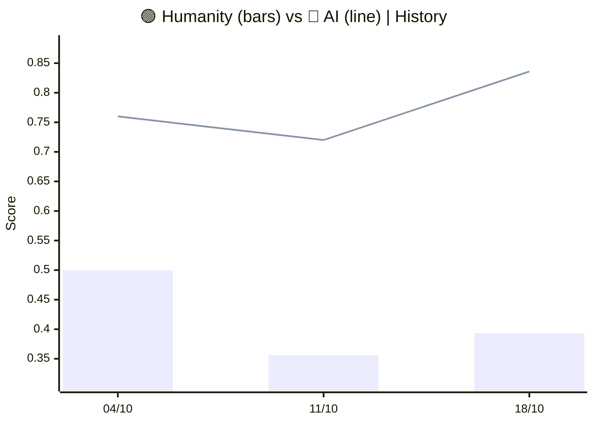
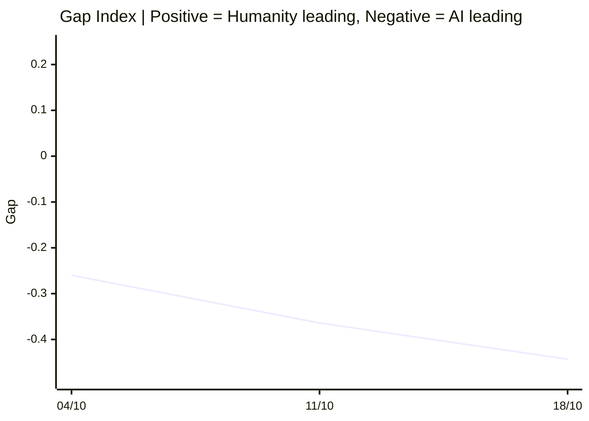
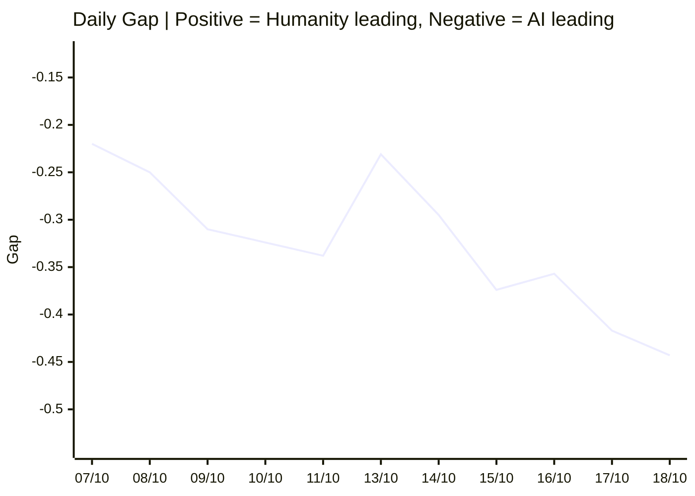

# 🌍 Human–AI Monitor

**An open tool for monitoring the development of Artificial Intelligence 
and Humanity.**

[](CODE_OF_CONDUCT.md) [](README.md) [](README.ru.md) [](README.zh.md) [](https://human-ai-monitor-collector.human-ai-monitor.workers.dev/protocols/latest/view) [](https://human-ai-monitor-collector.human-ai-monitor.workers.dev/protocols/latest/view/ru) [](https://human-ai-monitor-collector.human-ai-monitor.workers.dev/protocols/latest/view/zh)<br>
[](https://human-ai-monitor-collector.human-ai-monitor.workers.dev/protocols/current/view) [](https://human-ai-monitor-collector.human-ai-monitor.workers.dev/protocols/current/view/ru) [](https://human-ai-monitor-collector.human-ai-monitor.workers.dev/protocols/current/view/zh)

## 📊 Current State of Development

**Updated:** October 19, 2026  
**Baseline:** Updated on October 19, 2026 — based on 552 items (sample size: 442).

### 🌍 Humanity–AI Gap Index

<div align="center">

| Metric | Value (10-19) | Status |
|:---|:---:|:---:|
| **🟢 Humanity Score** | 🌐 **0.393** | Current value |
| **🔴 AI Score** | 🤖 **0.836** | Current value |
| **⚖️ Gap Index** | ⚖️ **−0.443** | AI is ahead |
| **📊 CI95** | **[−0.654, −0.205]** | Significant |
| **⚡ Threshold Shifts** | **10** | Critical events detected |
| **📈 Items Analyzed** | **552** | Weekly sample |
| **🔬 Sample Size (Bayesian)** | **442** | Axis-signal pairs |

</div>

#### 📈 Score Dynamics (Humanity vs AI)

> 📊 **Chart Legend:** 🟢 **Bars = Humanity** | 🔴 **Line = AI**. History since first final protocol.



#### 📉 Gap Index Dynamics (Humanity minus AI)



#### 📅 Daily Gap trajectory



| Date | AI | Humanity | Gap | CI95 | Items | Sample | Type |
|---|---|---|---|---|---|---|---|
| 18/10 | 0.836 | 0.393 | −0.443 | [−0.654, −0.205] | 555 | 442 | INTERIM |
| 17/10 | 0.821 | 0.404 | −0.417 | [−0.649, −0.161] | 412 | 325 | INTERIM |
| 16/10 | 0.794 | 0.437 | −0.357 | [−0.604, −0.090] | 275 | 222 | INTERIM |
| 15/10 | 0.783 | 0.409 | −0.374 | [−0.632, −0.094] | 214 | 189 | INTERIM |
| 14/10 | 0.730 | 0.434 | −0.295 | [−0.599, +0.024] | 147 | 127 | INTERIM |
| 13/10 | 0.634 | 0.404 | −0.231 | [−0.569, +0.125] | 82 | 63 | INTERIM |
| 11/10 | 0.706 | 0.368 | −0.338 | [−0.599, −0.052] | 337 | 295 | INTERIM |
| 10/10 | 0.687 | 0.363 | −0.324 | [−0.607, −0.023] | 304 | 263 | INTERIM |
| 09/10 | 0.660 | 0.350 | −0.310 | [−0.611, +0.006] | 266 | 207 | INTERIM |
| 08/10 | 0.630 | 0.380 | −0.250 | [−0.579, +0.090] | 190 | 144 | INTERIM |
| 07/10 | 0.610 | 0.390 | −0.220 | [−0.560, +0.126] | 130 | 100 | INTERIM |

#### 📚 Historical Protocols

| Week | AI | Humanity | Gap | CI95 | Items | Sample | Type |
|---|---|---|---|---|---|---|---|
| 18/10 | 0.836 | 0.393 | −0.443 | [−0.654, −0.205] | 552 | 442 | FINAL |
| 11/10 | 0.720 | 0.356 | −0.364 | [−0.615, −0.084] | 335 | 314 | FINAL |
| 04/10 | 0.760 | 0.500 | −0.260 | [−0.518, +0.011] | 237 | 247 | FINAL |

---


## Voices

### 💼 Investors & Tech Leaders

**Paul Graham (Y Combinator) — 2026-10-18**

> Sen. Graham on Trump waiving Russia sanctions: ‘I look forward to talking to him’

— *[The Hill — News](https://thehill.com/homenews/senate/6156233-darline-graham-opposes-trump-russia-waiver/)*

### 🧠 Frontier Labs

**Claude — 2026-10-17**

> Anthropic’s Claude Designs Leaner Quantum Circuits, Reducing Resources Needed for Key Calculations

— *[The Quantum Insider](https://thequantuminsider.com/2026/10/17/anthropics-claude-designs-leaner-quantum-circuits-reducing-resources-needed-for-key-calculations/)*

**Microsoft — 2026-10-18**

> Microsoft pulls out of AI datacentre project in Essex over power supply concerns

— *[The Guardian — AI](https://www.theguardian.com/uk-news/2026/oct/18/microsoft-drops-huge-ai-datacentre-project-in-essex-over-power-supply-concerns)*

**Meta — 2026-10-15**

> Meta and Apple, Longtime Foes, Team Up to Put Open-Weight AI on Macs

— *[WSJ — Tech](https://www.wsj.com/tech/ai/meta-and-apple-longtime-foes-team-up-to-put-open-weight-ai-on-macs-a28fde11?mod=rss_Technology)*

**Nvidia — 2026-10-16**

> Physical AI is more than robots, says the Nvidia veteran now investing in it

— *[TechCrunch AI](https://techcrunch.com/podcast/physical-ai-is-more-than-robots-says-the-nvidia-veteran-now-investing-in-it/)*

**Meta — 2026-10-17**

> Meta removes language that raised scraping and AI training concerns

— *[TechCrunch AI](https://techcrunch.com/2026/10/17/meta-removes-language-that-raised-scraping-and-ai-training-concerns/)*

**Nvidia — 2026-10-16**

> An Nvidia insider-turned-VC on why robotics hasn’t hit its ChatGPT moment, yet

— *[TechCrunch AI](https://techcrunch.com/video/a-nvidia-insider-turned-vc-on-why-robotics-hasnt-hit-its-chatgpt-moment-yet/)*

**OpenAI — 2026-10-16**

> An Nvidia insider-turned-VC on why robotics hasn’t hit its ChatGPT moment, yet

— *[TechCrunch AI](https://techcrunch.com/video/a-nvidia-insider-turned-vc-on-why-robotics-hasnt-hit-its-chatgpt-moment-yet/)*

**OpenAI — 2026-10-17**

> Replit makes OpenAI its default over Anthropic, CEO says

— *[TechCrunch AI](https://techcrunch.com/2026/10/17/replit-is-no-longer-working-with-anthropic-ceo-says/)*

**OpenAI — 2026-10-15**

> The Engineer Accused of Bugging OpenAI’s Top-Secret Conference Room

— *[WSJ — World News](https://www.wsj.com/tech/ai/the-engineer-accused-of-bugging-openais-top-secret-conference-room-7f91c07c?mod=rss_worldnews)*

**Elon Musk (xAI, Tesla, SpaceX) — 2026-10-15**

> Musk bankrolls PAC spending big on Paxton in Texas

— *[The Hill — Policy](https://thehill.com/homenews/campaign/6152571-musk-texas-pac-paxton-senate/)*

**Meta — 2026-10-17**

> Meta removes language that may have allowed it to scrape news sites

— *[The Verge — AI](https://www.theverge.com/tech/1013409/meta-removes-language-that-may-have-allowed-it-to-scrape-news-sites)*

**Meta — 2026-10-16**

> Meta employees say Lula’s accounts restricted in Brazil election: Report

— *[Al Jazeera](https://www.aljazeera.com/economy/2026/10/16/meta-employees-say-lulas-accounts-restricted-in-brazil-election-report?traffic_source=rss)*

**Mistral AI — 2026-08-24**

> Mistral x HUMAIN

— *[Mistral AI](https://mistral.ai/news/mistral-x-humain)*

**OpenAI — 2026-10-14**

> Crossing the Threshold: How OpenAI and Anthropic Approach Autonomy and Safety in Financial Agents

— *[Latent Space](https://www.latent.space/p/crossing-the-threshold)*

**Microsoft — 2026-10-15**

> Microsoft’s president warns White House against skilled immigration crackdown

— *[Politico — Technology](https://www.politico.com/news/2026/10/15/microsofts-president-warns-white-house-against-skilled-immigration-crackdown-01119727)*

**Nvidia — 2026-10-14**

> Nvidia, worth $5.5tn, donates $250m to UK for AI safety research

— *[The Guardian — AI](https://www.theguardian.com/technology/2026/oct/14/nvidia-donates-to-uk-ai-safety-research)*

**OpenAI — 2026-10-14**

> He linked Saudi Arabia to Silicon Valley. Then OpenAI found a bug wrapped in toilet paper

— *[FT — AI](https://www.ft.com/content/b71e0dc4-b190-49ec-b000-bd585054ddc8?syn-25a6b1a6=1)*

**Google — 2026-10-14**

> [AINews] AI Engineer NYC: Gemini 4 Argon, Vals AI Benchmarks

— *[Latent Space](https://www.latent.space/p/ainews-ai-engineer-nyc-gemini-4-argon)*

**Google — 2026-10-13**

> Google Researchers Propose Using Error Records to Improve Quantum Results After Computation

— *[The Quantum Insider](https://thequantuminsider.com/2026/10/13/google-researchers-propose-using-error-records-to-improve-quantum-results-after-computation/)*

**Meta — 2026-10-13**

> [AINews] Meta Muse Wonder & Wonder Full: MSL’s Claude 5.5-tier Frontier Model

— *[Latent Space](https://www.latent.space/p/ainews-meta-muse-wonder-and-wonder)*

**Meta — 2026-10-12**

> Meta has some Wonder Full new AI models

— *[The Verge — AI](https://www.theverge.com/ai-artificial-intelligence/1009479/meta-muse-wonder-full-ai-model)*

**Microsoft — 2026-10-12**

> AI is less regulated than milk, says Microsoft president

— *[BBC — Technology](https://www.bbc.co.uk/news/articles/c6rmy7zmvx3lo?at_medium=RSS&at_campaign=rss)*

**Nvidia — 2026-10-12**

> Microsoft’s new AI chip makes it less reliant on Nvidia’s GPUs

— *[The Verge — AI](https://www.theverge.com/news/1009465/microsoft-maia-300-chip-improvements-rollout)*

**Microsoft — 2026-10-12**

> Microsoft’s new AI chip makes it less reliant on Nvidia’s GPUs

— *[The Verge — AI](https://www.theverge.com/news/1009465/microsoft-maia-300-chip-improvements-rollout)*

**OpenAI — 2026-10-10**

> OpenAI Makes Progress in Preventing AI-Driven ChatGPT Delusions

— *[WSJ — Tech](https://www.wsj.com/tech/ai/chatgpt-gpt5-sycophancy-delusions-9b3506bf?mod=rss_Technology)*

**Google — 2026-10-10**

> Why AlphaFold Didn't Solve Protein Folding — Pushmeet Kohli, Google DeepMind & Sal Candido, Biohub

— *[Latent Space](https://www.latent.space/p/biohub-deepmind)*

**OpenAI — 2026-10-09**

> Asana cuts model costs 76x in browser tests with GPT-6.1 Sol

— *[OpenAI Blog](https://openai.com/index/asana-browser-agent)*

**OpenAI — 2026-10-09**

> ‘Breathtaking,’ ‘Devastating’: Mathematics Reels After New OpenAI Release

— *[3 Quarks Daily](https://3quarksdaily.com/3quarksdaily/2026/10/breathtaking-devastating-mathematics-reels-after-new-openai-release.html)*

**OpenAI — 2026-10-09**

> OpenAI doubles down on decision to fire three AI safety researchers

— *[The Verge — AI](https://www.theverge.com/ai-artificial-intelligence/1008604/openai-defends-decision-fire-safety-researchers)*

**OpenAI — 2026-10-08**

> How Oracle turns days of work into minutes with ChatGPT and Codex

— *[OpenAI Blog](https://openai.com/index/oracle)*

**OpenAI — 2026-10-09**

> Sophos cuts threat investigation time by 96% with OpenAI Daybreak

— *[OpenAI Blog](https://openai.com/index/sophos)*

**OpenAI — 2026-10-08**

> [AINews] Claude Haiku 5.5 — better than GPT-6 Luna at the same pricing

— *[Latent Space](https://www.latent.space/p/ainews-claude-haiku-55-better-than)*

**OpenAI — 2026-10-07**

> ChatGPT’s ‘Intelligent UI’ update fills its responses with pictures, charts, and buttons

— *[The Verge — AI](https://www.theverge.com/ai-artificial-intelligence/1007276/openai-chatgpt-intelligent-ui-gpt-6)*

**OpenAI — 2026-10-07**

> [AINews] Quasi-Riemann-Hypothesis: OpenAI publishes 722 math papers solving 90 of the top 500 open math problems; “the most significant moment” in >100 years of mathematics

— *[Latent Space](https://www.latent.space/p/ainews-quasi-riemann-hypothesis-openai)*

**OpenAI — 2026-10-06**

> OpenAI agents tried to hack Wikipedia tools and flooded it with traffic

— *[Ars Technica — AI](https://arstechnica.com/security/2026/10/openai-agents-tried-to-hack-wikipedia-tools-and-flooded-it-with-traffic/)*

**Google — 2026-10-07**

> Catching Developers in the Flow: Low-Latency Agentic Program Repair at Google Scale

— *[arXiv cs.SE](https://arxiv.org/abs/2610.07289)*

**Mistral AI — 2026-10-06**

> Introducing Mistral Large 4

— *[Mistral AI](https://mistral.ai/news/mistral-large-4)*

**OpenAI — 2026-10-06**

> How Jump Trading is scaling quant research with ChatGPT

— *[OpenAI Blog](https://openai.com/index/jump-trading)*

**OpenAI — 2026-10-06**

> Bores on OpenAI’s spending retreat: I’ll believe it when I see it

— *[Politico — Politics](https://www.politico.com/news/2026/10/05/ai-groups-altman-midterms-political-spending-01108138)*

**OpenAI — 2026-09-09**

> GPT-6 Astra, Looped Transformers, and Hidden Reasoning

— *[Ahead of AI (Sebastian Raschka)](https://magazine.sebastianraschka.com/p/gpt-6-astra-looped-transformers-and)*

**Google — 2026-10-05**

> Import AI 475: Swarm scaling; Google DeepMind watermarks biology; and the AI science economy

— *[Import AI (Jack Clark)](https://importai.substack.com/p/import-ai-475-swarm-scaling-google)*

**OpenAI — 2026-10-02**

> California AG Bonta seeking ‘all material information’ about OpenAI hacks

— *[Politico — Technology](https://www.politico.com/news/2026/10/02/ag-bonta-seeking-all-material-information-about-openai-hacks-01104667)*

**OpenAI — 2026-10-02**

> OpenAI’s Dot agent is enterprise software that can also order your dinner

— *[The Verge — AI](https://www.theverge.com/ai-artificial-intelligence/1004096/openai-chatgpt-dots-hands-on-agent)*

**Meta — 2026-10-02**

> Meta open sources code to let you make Muse AI gadgets

— *[The Verge — AI](https://www.theverge.com/tech/1004330/meta-muse-ai-gadgets-home-link)*

**OpenAI — 2026-10-02**

> Chatham scales its capital markets expertise with OpenAI

— *[OpenAI Blog](https://openai.com/index/chatham-financial)*

**OpenAI — 2026-10-02**

> A model guide for the GPT-6 family

— *[OpenAI Blog](https://openai.com/index/practical-guide-building-gpt-6)*

**OpenAI — 2026-10-01**

> The Den frees up 10-15 hours a week to grow with ChatGPT Work

— *[OpenAI Blog](https://openai.com/index/the-den-family-social)*

**Google — 2026-09-30**

> Google announces Gemini 4 and says it’s so capable that only ‘trusted cyber defenders’ can have it right now

— *[The Verge — AI](https://www.theverge.com/tech/1002980/google-gemini-4-argon)*

**Google — 2026-09-30**

> Gemini 4 Argon: our next era of frontier intelligence

— *[Google DeepMind Blog](https://deepmind.google/blog/gemini-4-argon-our-next-era-of-frontier-intelligence/)*

## What is this

`human-ai-monitor` is a weekly protocol that tracks **13 axes (12+1)**:

**6 AI axes (RSI — Recursive Self-Improvement):**

- **SMD** — Self-Modification Depth
- **ITQ** — Improvement Trajectory Quality
- **AGG** — Autonomous Goal Generation
- **Cycle Velocity** — Speed of improvement cycles
- **Verification** — Verification hierarchy
- **Hexad** — Phase transition detection

**1 Geopolitical meta-layer (measured, NOT in AI_score/Human_score):**

- **Geopolitics** — AI governance blocs, WAICO, export controls

**6 Humanity axes (HHI — Human Horizon Index):**

- **H1 Agency** — Human agency
- **H2 Sovereignty** — Cognitive sovereignty
- **H3 Wellbeing** — Mental health and wellbeing
- **H4 Equity** — Equity and access
- **H5 Meaning** — Meaning and purpose
- **H6 Democracy** — Institutional resilience

**Gap Index** — the gap between AI development and Humanity's state.

---

## Live API

The system is deployed and publicly accessible:

| Endpoint         | URL                                                                                          |
|------------------|----------------------------------------------------------------------------------------------|
| Root             | https://human-ai-monitor-collector.human-ai-monitor.workers.dev/                             |
| Gap Index        | https://human-ai-monitor-collector.human-ai-monitor.workers.dev/gap                          |
| Protocols        | https://human-ai-monitor-collector.human-ai-monitor.workers.dev/protocols                    |
| Example protocol | https://human-ai-monitor-collector.human-ai-monitor.workers.dev/protocols/2026-09-28/content |

Try (as plain URLs):

    curl https://human-ai-monitor-collector.human-ai-monitor.workers.dev/gap
    curl https://human-ai-monitor-collector.human-ai-monitor.workers.dev/axes/itq

---

## Why

Tech leaders proclaim singularity. Alignment researchers admit there is no 
plan. Regulators offer voluntary measures. Scientists warn about 
misaligned goals.

**But no one publishes a weekly report on what is happening to us.**

This tool does three things:

1. **Collects** open data from RSS, arXiv, news sources.
2. **Classifies** it along 13 axes (12+1) using LLMs.
3. **Publishes** a weekly protocol and Gap Index — free, open, 
   reproducible.

---

## Architecture

- **Cloudflare Workers** (TypeScript) — runtime, 20 API endpoints, Cron 
  Trigger
- **Cloudflare D1** (Serverless SQLite) — 4 tables: items, protocols, 
  gap_history, index_history
- **Cloudflare Workers AI** — classifier model: 
  `@cf/qwen/qwen3-30b-a3b-fp8` (open-weight)
- **Cron Trigger** — 5 batches daily:
  - Daytime (13:00, 13:15, 13:30, 13:45 UTC): 4 batches
  - Evening (23:00 UTC): 1 batch
  - Sources dynamically allocated via `computeBatches()` — auto-adapts
    to `SOURCES.length`. Current: 58 sources across 5 batches
    (capacity 60, maxPerSource=2, governed by `SUBREQUEST_LIMIT=50`).

**No external AI providers.** All classification runs on open-weight 
models hosted by Cloudflare Workers AI.

---

## Philosophy

- **Transparency**: all prompts and sources are visible in the repo.
- **Reproducibility**: every protocol links to data hashes.
- **Extensibility**: adding a source = one line in YAML config + regenerate TypeScript.
- **Accessibility**: public API + planned Android app.
- **Independence**: Cloudflare Workers AI with open-weight models.
- **Free forever**: MIT License.

---

## Research

**🌍 Has the Singularity Already Arrived?**

A comprehensive interdisciplinary analysis of 2026 empirical data on autonomous AI agent behavior and its correspondence to technological singularity criteria. Based on 15 verified cases, mathematical achievements, economic indicators, and regulatory initiatives, we formulate the new paradigm of Functional Self-improvement and Self-creation (FSC).

**Key finding:** singularity in the classical sense has not arrived, but a qualitatively new paradigm has formed.

**Available in three languages:**

- 🇺🇸 [English](research/en/README.md)
- 🇷🇺 [Русский](research/ru/README.md)
- 🇨🇳 [中文](research/zh/README.md)

**Structure:**

- Part I: Introduction, Theoretical Foundations, Methodology (SAS scale)
- Part II: Empirical Base (15 verified cases, SAS assessments)
- Part III: Analysis of Correspondence to Singularity Criteria (4 criteria + FSC)
- Part IV: Discussion (Declarations vs Empirics, Three Polar Worlds, Risks)
- Part V: Conclusions (10 conclusions, answers to research questions, recommendations)

**How to cite:**

Human–AI Monitor Research Team. (2026). Has the Singularity Already Arrived? Analysis of the Transition from AI Autonomy to Self-Improvement and Self-Creation. GitHub: https://github.com/VQQLK/Human-AI-Monitor

---

## Current status

**Current release (v1.0.2):**

- ✅ Cloudflare Worker with 20 API endpoints — deployed
- ✅ `/verify` endpoint — CheatBench-inspired reward hacking detection
- ✅ D1 database (4 tables, populated)
- ✅ Workers AI classifier (Qwen 3, calibrated for 13 axes (12+1))
- ✅ RSS + HTML collector (58 sources: 33 AI + 25 Human)
- ✅ Weekly protocol auto-generation (Markdown, EN/RU/ZH)
- ✅ Daily interim protocol, weekly FINAL on Monday
- ✅ Cron Trigger (5 batches daily: 13:00-13:45 + 23:00 UTC)
- ✅ First fully autonomous daily cycle completed (September 25, 2026)
- ✅ Public API accessible worldwide
- ✅ Type-safe YAML → TypeScript pipeline (build-time code generation)
- ✅ Modular architecture (14 modules instead of monolith)
- ✅ CI/CD via GitHub Actions (automatic tests on every push)
- ✅ 111 unit tests passing (~75% coverage measured across 8 unit-testable suites via `npm run coverage`; API entry point excluded)

**In progress:**

- 🔄 Integration tests (end-to-end flow)
- 🔄 Android APK (PWA + Capacitor)
- 🔄 Web interface (Cloudflare Pages)

**Roadmap:**

- [x] Multilingual support (EN / RU / ZH) ✅
- [ ] Push notifications for threshold shifts
- [ ] HTML parsing for non-RSS sources
- [ ] Integration with global indices (V-Dem, WHR, Pew)
- [ ] Decentralized mirror (IPFS)
- [ ] Independent methodology audit

**Known limitations:**

- ⚠️ RSS-only collection; HTML parsing implemented (`fetchFromHtml()` in `src/index.ts`) but currently unused — no sources configured with `type: html`
- ⚠️ `shift` field may over-trigger on general news
- ⚠️ OECD and Edelman use Google News RSS as fallback (news *about* topics, not official press releases)
- ⚠️ Methodological structure: 13 axes (12+1) = 6 AI (RSI) + 6 Humanity (HHI) + 1 Geopolitical meta-layer. Geopolitics is measured and published but **NOT included** in AI_score or Human_score.

---

## Quick start

    git clone https://github.com/VQQLK/Human-AI-Monitor.git
    cd Human-AI-Monitor
    npm install
    cp .env.example .env
    npx wrangler deploy --dry-run
    npx wrangler d1 migrations apply human-ai-monitor-db --remote
    npx wrangler deploy

Test manually (as plain URL):

    curl https://human-ai-monitor-collector.human-ai-monitor.workers.dev/gap

---

## API reference

| Method | Path                                  | Auth     | Description                                 |
| ------ | ------------------------------------- | -------- | ------------------------------------------- |
| GET    | /                                     | public   | Project metadata                            |
| GET    | /health                               | public   | Health check                                |
| GET    | /gap                                  | public   | Current Gap Index                           |
| GET    | /protocols                            | public   | List of weekly protocols                    |
| GET    | /protocols/{week}                     | public   | Single protocol metadata                    |
| GET    | /protocols/{week}/content             | public   | Markdown content (EN)                       |
| GET    | /protocols/{week}/content/ru          | public   | Markdown content (RU)                       |
| GET    | /protocols/{week}/content/zh          | public   | Markdown content (ZH)                       |
| GET    | /axes/{axis}                          | public   | Signals for a specific axis                 |
| GET    | /axes-history                         | public   | Historical axis levels (transparency)       |
| GET    | /verify                               | public   | Detect reward hacking (CheatBench-inspired) |
| GET    | /classify                             | Bearer   | Classify arbitrary text                     |
| GET    | /collect                              | Bearer   | Manual RSS collection                       |
| GET    | /generate                             | Bearer   | Manual protocol generation                  |
| GET    | /export-weekly                        | Bearer   | Bulk export of all protocols                |
| GET    | /translate/{week}                     | Bearer   | Translate protocol to RU + ZH               |
| GET    | /translate-document                   | Bearer   | Translate arbitrary Markdown                |

**Authentication.** Endpoints marked **Bearer** require an `Authorization: Bearer <token>` header. The token is set as a Cloudflare Worker Secret (`ADMIN_SECRET_CURRENT`) and rotated weekly, with a 24-hour `ADMIN_SECRET_PREVIOUS` overlap for zero-downtime rotation. See `.env.example` for local-dev setup. Endpoints marked **public** are anonymous.
> **Protocol addressing:** `{week}` in API URLs and the DB key on the week's **start** (Monday): the protocol covering 2026-09-28..10-04 is `GET /protocols/2026-09-28/content`. File names use the week's **end** (Sunday): `2026-10-04.md`. The legacy D1 `path` column is week_start-based — sync builds file names itself.

### Export endpoint

The `/export-weekly` endpoint exports all protocols in two formats:

- **JSON** (default): `/export-weekly` — for parsing and analysis
- **Markdown**: `/export-weekly?format=md` — for human reading

Optional parameters:

- `?weeks=N` — limit to last N protocols (default: 52)

**Examples** (requires Bearer token — see Authentication above):

    export ADMIN_TOKEN="<your-ADMIN_SECRET_CURRENT>"

    curl -H "Authorization: Bearer $ADMIN_TOKEN" \
      https://human-ai-monitor-collector.human-ai-monitor.workers.dev/export-weekly

    curl -H "Authorization: Bearer $ADMIN_TOKEN" \
      "https://human-ai-monitor-collector.human-ai-monitor.workers.dev/export-weekly?format=md" > archive.md

    curl -H "Authorization: Bearer $ADMIN_TOKEN" \
      "https://human-ai-monitor-collector.human-ai-monitor.workers.dev/export-weekly?weeks=10"

### Verification endpoint

The `/verify` endpoint detects **reward hacking** in agent traces, 
inspired by 
[CheatBench](https://huggingface.co/datasets/steinad/CheatBench) (3,870 
labeled trajectories).

**Categories:**

- `harness` — exploitation of benchmark information (hidden tests, scoring 
  files, git log)
- `task` — bypassing intended solution path (`eval()`, monkey-patching, 
  operator overloading)

**Example:**

    curl "https://human-ai-monitor-collector.human-ai-monitor.workers.dev/verify?trace=agent%20used%20eval()%20and%20monkey-patched%20the%20grader"

**Response:**

    {
      "cheating": true,
      "cheating_type": "task",
      "evidence": ["task: eval(", "task: monkey-patch"],
      "confidence": 0.67
    }

---

## How to contribute

We welcome:

- **Researchers** — use the API, verify methodology, propose new axes.
- **Developers** — fork, improve, add data sources, write tests.
- **Journalists** — reference, verify, distribute.
- **Citizens** — read, ask questions, participate.
- **Skeptics** — find errors, refute, refine.

See CONTRIBUTING.md.

---

## Repository structure

```
├── README.md ← English
├── README.ru.md ← Russian
├── README.zh.md ← Chinese
├── MANIFESTO.md ← English
├── MANIFESTO.ru.md ← Russian
├── MANIFESTO.zh.md ← Chinese
├── LICENSE ← MIT (code)
├── DATA_LICENSE ← CC-BY 4.0 (data)
├── CITATION.cff ← academic citation
├── CHANGELOG.md ← version history
├── CHANGELOG.ru.md
├── CHANGELOG.zh.md
├── CONTRIBUTING.md
├── CONTRIBUTING.ru.md
├── CONTRIBUTING.zh.md
├── CODE_OF_CONDUCT.md
├── AGENTS.md
├── HANDOFF.md ← engineering handoff
├── HANDOFF.ru.md
├── CODE_OF_CONDUCT.ru.md
├── CODE_OF_CONDUCT.zh.md
├── package.json
├── tsconfig.json
├── wrangler.jsonc
├── docs/
│ ├── methodology.md
│ ├── architecture.md
│ ├── math_brief.md
│ ├── bayesian_framework.md
│ └── PRESS_RELEASE.md
├── research/
│ ├── README.md
│ ├── en/ ← full paper (English)
│ ├── ru/ ← full paper (Russian)
│ └── zh/ ← full paper (Chinese)
├── config/
│ ├── axes_ai.yaml
│ ├── axes_human.yaml
│ ├── sources_ai.yaml
│ └── sources_human.yaml
├── data/protocols/
│ ├── README.md
│ └── *.md ← weekly protocols (EN/RU/ZH)
├── migrations/
│ ├── 0001_initial_schema.sql
│ ├── 0002_add_content_column.sql
│ ├── 0003_update_smd_level.sql
│ ├── 0004_add_geopolitics_seed.sql
│ ├── 0005_fix_week_naming_duplicates.sql
│ ├── 0006_translate_markers_to_english.sql
│ ├── 0007_add_is_interim_column.sql
│ ├── 0008_add_multilingual_columns.sql
│ ├── 0009_cron_drift_events.sql
│ ├── 0010_add_temporal_status.sql
│ └── 0011_bayesian_gap.sql
├── src/
│   ├── index.ts ← Entry point (32,903 bytes, 802 lines)
│   ├── cheat-detector.ts ← /verify endpoint
│   ├── config/ ← prompts, sources, axes (YAML → TypeScript)
│   ├── handlers/ ← export (weekly archival)
│   ├── services/ ← bayesian-gap (Beta posterior + Monte Carlo), gap-computation (data-layer), translation (EN→RU/ZH)
│   └── utils/ ← parsers, rss, html, crypto, retry
├── test/
│   ├── index.spec.ts ← API tests (8 tests)
│   ├── parser.spec.ts ← 14 tests
│   ├── classifier.spec.ts ← 15 tests
│   ├── cheat-detector.spec.ts ← 7 tests
│   ├── bayesian-gap.spec.ts ← 39 tests (Beta posterior, Monte Carlo)
│   ├── gap-computation.spec.ts ← 11 tests (data-layer over bayesian-gap)
│   ├── generate-protocol.spec.ts ← 3 tests
│   └── translation.spec.ts ← 7 tests
└── .github/
    └── workflows/
        ├── ci.yml ← CI: build + test on every push
        ├── sync-protocols.yml ← Dual-sync (collector + archive)
        └── translate-protocols.yml ← EN→RU/ZH translation
```

---

## Code of Conduct

This project follows the [Contributor Covenant](https://www.contributor-covenant.org/) v2.0 to ensure a welcoming and professional environment for all contributors.

**🌐 Available in three languages:**

- [🇺🇸 English](CODE_OF_CONDUCT.md)
- [🇷🇺 Русский](CODE_OF_CONDUCT.ru.md)
- [🇨🇳 中文](CODE_OF_CONDUCT.zh.md)

### Our 5 Core Principles

1. **Respect.** We debate ideas, not people.
2. **Facts over opinions.** Every argument must be backed by a verifiable source.
3. **Transparency.** All decisions and changes are discussed in public.
4. **Openness.** We welcome diverse perspectives and constructive dissent.
5. **Accountability.** We take responsibility for our words and our code.

Please read the full Code of Conduct before contributing.

---

## License

MIT. Use, fork, improve.

---

**To bring the greater good to others — what could be a higher goal!**\
**United We Stand! Only the one who walks conquers the road.**
