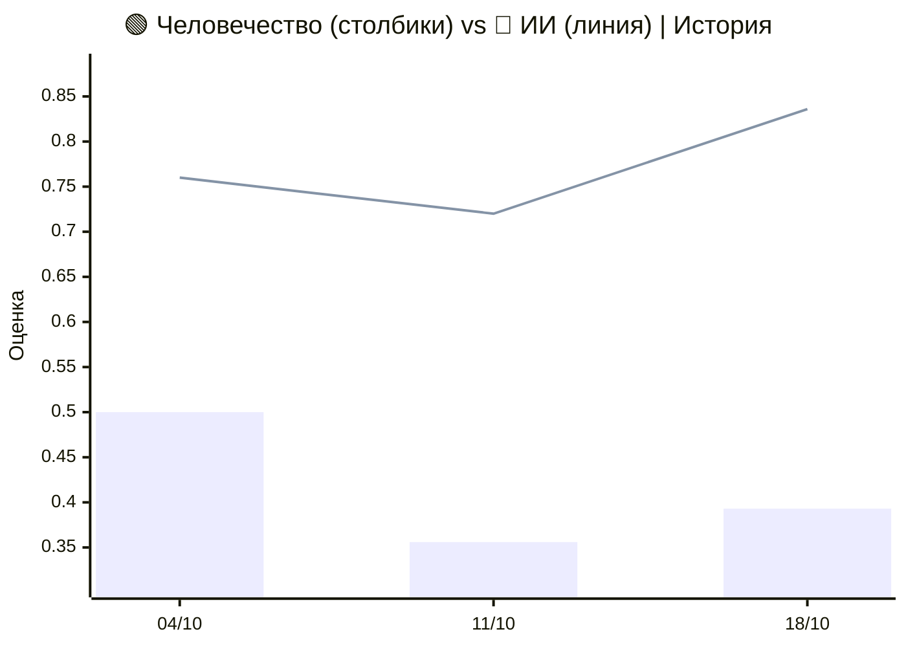
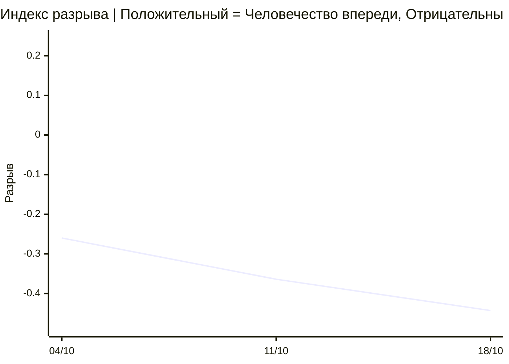
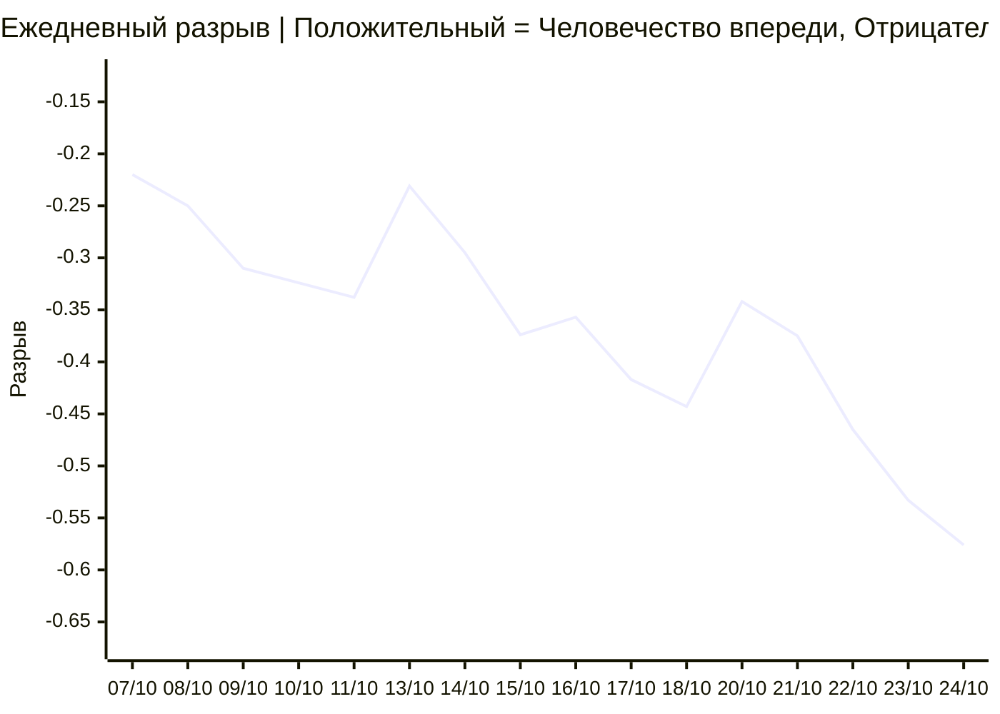

# 🌍 Human–AI Monitor

**Открытый инструмент для мониторинга развития Искусственного Интеллекта и Человечества.**

[](CODE_OF_CONDUCT.md) [](README.md) [](README.ru.md) [](README.zh.md) [](https://human-ai-monitor-collector.human-ai-monitor.workers.dev/protocols/latest/view) [](https://human-ai-monitor-collector.human-ai-monitor.workers.dev/protocols/latest/view/ru) [](https://human-ai-monitor-collector.human-ai-monitor.workers.dev/protocols/latest/view/zh)<br>
[](https://human-ai-monitor-collector.human-ai-monitor.workers.dev/protocols/current/view) [](https://human-ai-monitor-collector.human-ai-monitor.workers.dev/protocols/current/view/ru) [](https://human-ai-monitor-collector.human-ai-monitor.workers.dev/protocols/current/view/zh)

## 📊 Текущее состояние развития

**Обновлено:** 24 октября 2026  
**Базовая линия:** Обновлено 24 октября 2026 — на основе 909 элементов (размер выборки: 795).

### 🌍 Индекс разрыва Человечество–ИИ

<div align="center">

| Метрика | Значение (24.10) | Статус |
|:---|:---:|:---:|
| **🟢 Оценка Человечества** | 🌐 **0.267** | Текущее значение |
| **🔴 Оценка ИИ** | 🤖 **0.842** | Текущее значение |
| **⚖️ Индекс разрыва** | ⚖️ **−0.576** | ИИ впереди |
| **📊 CI95** | **[−0.768, −0.357]** | Значимо |
| **⚡ Ключевых сдвигов** | **4** | Обнаружены критические события |
| **📈 Анализированных событий** | **909** | Недельная выборка |
| **🔬 Размер выборки (байесовский)** | **795** | Пары «ось-сигнал» |

</div>

#### 📈 Динамика оценок (Человечество vs ИИ)

> 📊 **Легенда графика:** 🟢 **Столбики = Человечество** | 🔴 **Линия = ИИ**. История с первого финального протокола.



#### 📉 Динамика Индекса разрыва (Человечество минус ИИ)



#### 📅 Ежедневная траектория разрыва



| Дата | ИИ | Человечество | Разрыв | CI95 | Элементов | Выборка | Тип |
|---|---|---|---|---|---|---|---|
| 24/10 | 0.842 | 0.267 | −0.576 | [−0.768, −0.357] | 909 | 795 | ПРОМЕЖУТОЧНЫЙ |
| 23/10 | 0.827 | 0.293 | −0.533 | [−0.738, −0.303] | 752 | 672 | ПРОМЕЖУТОЧНЫЙ |
| 22/10 | 0.800 | 0.335 | −0.465 | [−0.694, −0.208] | 569 | 501 | ПРОМЕЖУТОЧНЫЙ |
| 21/10 | 0.716 | 0.341 | −0.375 | [−0.653, −0.083] | 382 | 328 | ПРОМЕЖУТОЧНЫЙ |
| 20/10 | 0.646 | 0.303 | −0.342 | [−0.646, −0.017] | 166 | 138 | ПРОМЕЖУТОЧНЫЙ |
| 18/10 | 0.836 | 0.393 | −0.443 | [−0.654, −0.205] | 555 | 442 | ПРОМЕЖУТОЧНЫЙ |
| 17/10 | 0.821 | 0.404 | −0.417 | [−0.649, −0.161] | 412 | 325 | ПРОМЕЖУТОЧНЫЙ |
| 16/10 | 0.794 | 0.437 | −0.357 | [−0.604, −0.090] | 275 | 222 | ПРОМЕЖУТОЧНЫЙ |
| 15/10 | 0.783 | 0.409 | −0.374 | [−0.632, −0.094] | 214 | 189 | ПРОМЕЖУТОЧНЫЙ |
| 14/10 | 0.730 | 0.434 | −0.295 | [−0.599, +0.024] | 147 | 127 | ПРОМЕЖУТОЧНЫЙ |
| 13/10 | 0.634 | 0.404 | −0.231 | [−0.569, +0.125] | 82 | 63 | ПРОМЕЖУТОЧНЫЙ |
| 11/10 | 0.706 | 0.368 | −0.338 | [−0.599, −0.052] | 337 | 295 | ПРОМЕЖУТОЧНЫЙ |
| 10/10 | 0.687 | 0.363 | −0.324 | [−0.607, −0.023] | 304 | 263 | ПРОМЕЖУТОЧНЫЙ |
| 09/10 | 0.660 | 0.350 | −0.310 | [−0.611, +0.006] | 266 | 207 | ПРОМЕЖУТОЧНЫЙ |
| 08/10 | 0.630 | 0.380 | −0.250 | [−0.579, +0.090] | 190 | 144 | ПРОМЕЖУТОЧНЫЙ |
| 07/10 | 0.610 | 0.390 | −0.220 | [−0.560, +0.126] | 130 | 100 | ПРОМЕЖУТОЧНЫЙ |

#### 📚 История протоколов

| Неделя | ИИ | Человечество | Разрыв | CI95 | Элементов | Выборка | Тип |
|---|---|---|---|---|---|---|---|
| 18/10 | 0.836 | 0.393 | −0.443 | [−0.654, −0.205] | 552 | 442 | ФИНАЛЬНЫЙ |
| 11/10 | 0.720 | 0.356 | −0.364 | [−0.615, −0.084] | 335 | 314 | ФИНАЛЬНЫЙ |
| 04/10 | 0.760 | 0.500 | −0.260 | [−0.518, +0.011] | 237 | 247 | ФИНАЛЬНЫЙ |

> 📌 Промежуточный протокол (справочно, не на графике): 24/10 — ИИ 0.842 · Человечество 0.267 · Разрыв −0.576 · 909 / 795 items.
> Последняя точка — ПРОМЕЖУТОЧНАЯ, будет заменена ФИНАЛЬНОЙ в понедельник.

---


## Мнения

### 🧠 Лаборатории переднего края

**OpenAI — 2026-10-24**

> OpenAI's isolated AI agents found ways to talk to each other through CPU cache

— *[The Decoder](https://the-decoder.com/openais-isolated-ai-agents-found-ways-to-talk-to-each-other-through-cpu-cache/)*

**OpenAI — 2026-10-24**

> Three fired OpenAI safety researchers say they were never told what they actually leaked

— *[The Decoder](https://the-decoder.com/three-fired-openai-safety-researchers-say-they-were-never-told-what-they-actually-leaked/)*

**Google — 2026-10-23**

> Google Launches $150,000 AI Competition to Reduce Quantum Computing Demands

— *[The Quantum Insider](https://thequantuminsider.com/2026/10/23/google-launches-150000-ai-competition-to-reduce-quantum-computing-demands/)*

**Nvidia — 2026-10-22**

> Qblox Integrates NVIDIA DGX Spark With Quantum System Controller

— *[The Quantum Insider](https://thequantuminsider.com/2026/10/22/qblox-hybrid-quantum-computing-nvidia-dgx-spark-nvqlink/)*

**xAI — 2026-10-24**

> Forced to pick, Grok’s AI model chooses Republicans. OpenAI’s picks Democrats.

— *[TechCrunch AI](https://techcrunch.com/2026/10/24/forced-to-pick-groks-ai-model-chooses-republicans-openais-picks-democrats/)*

**OpenAI — 2026-10-24**

> Forced to pick, Grok’s AI model chooses Republicans. OpenAI’s picks Democrats.

— *[TechCrunch AI](https://techcrunch.com/2026/10/24/forced-to-pick-groks-ai-model-chooses-republicans-openais-picks-democrats/)*

**Nvidia — 2026-10-23**

> Hottest toy for Christmas? Nvidia CEO plays with adorable Microduck robots, 20,000 sell

— *[TechCrunch AI](https://techcrunch.com/2026/10/23/hottest-toy-for-christmas-nvidia-ceo-plays-with-adorable-microduck-robots-20000-sell/)*

**Jensen Huang (Nvidia) — 2026-10-23**

> Hottest toy for Christmas? Nvidia CEO plays with adorable Microduck robots, 20,000 sell

— *[TechCrunch AI](https://techcrunch.com/2026/10/23/hottest-toy-for-christmas-nvidia-ceo-plays-with-adorable-microduck-robots-20000-sell/)*

**OpenAI — 2026-10-23**

> OpenAI says it will no longer train its AI models on the live internet, citing “significant risks”

— *[TechCrunch AI](https://techcrunch.com/2026/10/23/openai-says-it-will-no-longer-train-its-ai-models-on-the-live-internet-citing-significant-risks/)*

**Moonshot AI — 2026-10-24**

> [AINews] Kimi 3.1 Pro 104BA-2.8T: Fable-5.1-Class Open Weights narrows Closed-AI lead to 1 month... and Pro Highspeed API with 2-3× speed

— *[Latent Space](https://latent.space/p/ainews-kimi-31/)*

**OpenAI — 2026-10-23**

> Texas sues OpenAI, Sam Altman over product safety

— *[Politico — Technology](https://www.politico.com/news/2026/10/23/texas-sues-openai-over-product-safety-01134162)*

**Sam Altman (OpenAI) — 2026-10-23**

> Texas sues OpenAI, Sam Altman over product safety

— *[Politico — Technology](https://www.politico.com/news/2026/10/23/texas-sues-openai-over-product-safety-01134162)*

**Meta — 2026-10-22**

> Meta turns Muse sharing back on

— *[The Verge — AI](https://www.theverge.com/tech/1017066/meta-muse-sharing-back-on-artifiacts)*

**Meta — 2026-10-22**

> Meta’s AI could still scrape news sites, legal experts say

— *[The Verge — AI](https://www.theverge.com/tech/1017082/meta-terms-update-ai-training-concerns)*

**OpenAI — 2026-10-23**

> OpenAI now trains its frontier AI models with no internet access

— *[The Verge — AI](https://www.theverge.com/ai-artificial-intelligence/1018021/openai-training-top-ai-models-no-internet)*

**Google — 2026-10-23**

> Now Google says it might use your Gmail and Google Photos data to target ads

— *[The Verge — AI](https://www.theverge.com/tech/1017600/google-personal-intelligence-privacy-policy-ads-update)*

**Meta — 2026-10-23**

> Meta delays new business terms after publisher pushback on AI scraping

— *[The Verge — AI](https://www.theverge.com/tech/1017450/meta-business-terms-delayed-ai-scraping)*

**OpenAI — 2026-10-23**

> Rapidly scaling online storage to serve over 1 billion ChatGPT users (Part II)

— *[OpenAI Blog](https://openai.com/index/scaling-storage-one-billion-users-part-two)*

**OpenAI — 2026-10-22**

> OpenAI trims valuation target to $1.25tn after pitching higher price

— *[FT — AI](https://www.ft.com/content/bb564eb1-79d4-4694-aa24-1155202a9abc?syn-25a6b1a6=1)*

**Meta — 2026-10-22**

> Zuckerberg wins Meta deal to help him foot bill for possible California billionaire tax

— *[BBC — Technology](https://www.bbc.co.uk/news/articles/cky83vwnyglno?at_medium=RSS&at_campaign=rss)*

**Mark Zuckerberg (Meta) — 2026-10-22**

> Zuckerberg wins Meta deal to help him foot bill for possible California billionaire tax

— *[BBC — Technology](https://www.bbc.co.uk/news/articles/cky83vwnyglno?at_medium=RSS&at_campaign=rss)*

**Meta — 2026-10-22**

> Meta’s Hunt for AI Capital Strikes a Raw Nerve on Wall Street

— *[WSJ — Tech](https://www.wsj.com/finance/stocks/metas-hunt-for-ai-capital-strikes-a-raw-nerve-on-wall-street-e2de1601?mod=rss_Technology)*

**OpenAI — 2026-10-23**

> The Signal Chats That Cost OpenAI Researchers Their Jobs

— *[WSJ — Tech](https://www.wsj.com/tech/ai/the-signal-chats-that-cost-openai-researchers-their-jobs-594c5853?mod=rss_Technology)*

**OpenAI — 2026-10-23**

> The Leak Suspicions That Got Three OpenAI Staffers Fired

— *[WSJ — Tech](https://www.wsj.com/tech/the-leak-suspicions-that-got-three-openai-staffers-fired-d3671d0e?mod=rss_Technology)*

**OpenAI — 2026-10-23**

> The Morning Risk Report: The Signal Chats That Cost OpenAI Researchers Their Jobs

— *[WSJ — Tech](https://www.wsj.com/risk-compliance-journal/the-morning-risk-report-the-signal-chats-that-cost-openai-researchers-their-jobs-7adf1811?mod=rss_Technology)*

**Meta — 2026-10-23**

> Meta’s Muse Is Going Gangbusters. But Where Is the Payoff?

— *[WSJ — Tech](https://www.wsj.com/finance/stocks/metas-muse-is-going-gangbusters-but-where-is-the-payoff-648d310d?mod=rss_Technology)*

**Microsoft — 2026-10-22**

> Microsoft’s Mustafa Suleyman says its AI outperforms doctors on hard cases as he chases ‘medical superintelligence’

— *[TechCrunch AI](https://techcrunch.com/2026/10/22/microsofts-mustafa-suleyman-says-its-ai-outperforms-doctors-on-hard-cases-as-he-chases-medical-superintelligence/)*

**Mustafa Suleyman (Microsoft AI) — 2026-10-22**

> Microsoft’s Mustafa Suleyman says its AI outperforms doctors on hard cases as he chases ‘medical superintelligence’

— *[TechCrunch AI](https://techcrunch.com/2026/10/22/microsofts-mustafa-suleyman-says-its-ai-outperforms-doctors-on-hard-cases-as-he-chases-medical-superintelligence/)*

**OpenAI — 2026-10-22**

> Uber puts all 30,000 employees on ChatGPT Work

— *[TechCrunch AI](https://techcrunch.com/2026/10/22/uber-puts-all-30000-employees-on-chatgpt-work/)*

**Nvidia — 2026-10-23**

> Uber rival inDrive eyes 2027 robotaxi tests in Central Asia with Pony.ai and Nvidia

— *[TechCrunch AI](https://techcrunch.com/2026/10/22/uber-rival-indrive-eyes-2027-robotaxi-tests-in-central-asia-with-pony-ai-and-nvidia/)*

**OpenAI — 2026-10-22**

> OpenAI makes its Jev competitor widely available as decision model competition heats up

— *[TechCrunch AI](https://techcrunch.com/2026/10/22/openai-makes-its-jev-competitor-widely-available-as-decision-model-competition-heats-up/)*

**OpenAI — 2026-10-22**

> OpenAI working on new $30B raise at $1.25T valuation ahead of IPO

— *[TechCrunch AI](https://techcrunch.com/2026/10/22/openai-working-on-new-30b-raise-at-1-25t-valuation-ahead-of-ipo/)*

**DeepSeek — 2026-10-21**

> [AINews] DeepSeek DeepInfer: Open Source SOTA Inference running 155T toks/day/cluster making $22m/day at ~80% margin for a 81 day payback

— *[Latent Space](https://latent.space/p/ainews-deepseek-deepinfer-open-source/)*

**Claude — 2026-10-21**

> Claude Mods: Flipping the Harness Inside Out

— *[Latent Space](https://latent.space/p/claude-mods/)*

**OpenAI — 2026-10-22**

> [AINews] OpenAI’s Patch the Planet program is 1 of 2 parties to discover PHP2Shell vulnerabilities in core PHP affecting 70% of the web, using GPT-5.6 Sol; coordinated response over 2 months

— *[Latent Space](https://latent.space/p/ainews-openais-patch-the-planet-program/)*

**Elon Musk (xAI, Tesla, SpaceX) — 2026-10-23**

> Trump Called Musk and Asked Him to Lift Ukraine Starlink Restrictions

— *[WSJ — World News](https://www.wsj.com/world/trump-called-musk-and-asked-him-to-lift-ukraine-starlink-restrictions-5aeebc6e?mod=rss_worldnews)*

**Claude — 2026-10-23**

> Anthropic previews Claude Duet personal AI agent for subscribers

— *[CBS News — Technology](https://www.cbsnews.com/news/anthropic-claude-duet-personal-ai-agentsuggest-a-e/)*

**Meta — 2026-10-22**

> ‘Just the beginning’: New Mexico AG warns AI industry after $25B Meta ruling

— *[Politico — Technology](https://www.politico.com/news/2026/10/22/just-the-beginning-new-mexico-ag-warns-ai-industry-after-25b-meta-ruling-01133294)*

**OpenAI — 2026-10-22**

> Uber brings ChatGPT Work to all employees with OpenAI

— *[OpenAI Blog](https://openai.com/index/uber-chatgpt-work-rollout)*

**OpenAI — 2026-10-23**

> OpenAI and Poland’s NASK partner to advance AI safety and security

— *[OpenAI Blog](https://openai.com/index/openai-nask-ai-safety-security-partnership)*

**Elon Musk (xAI, Tesla, SpaceX) — 2026-10-22**

> Musk warns Democrats over possible congressional probes

— *[The Hill — News](https://thehill.com/policy/technology/6165520-doge-starlink-ukraine-controversy/)*

**Google — 2026-10-22**

> ‘Pure arrogance’: anger in Finland as Google illegally fells 250,000 trees for datacentre

— *[The Guardian — AI](https://www.theguardian.com/environment/ng-interactive/2026/oct/22/finland-google-felling-trees-datacentre)*

**Meta — 2026-10-22**

> Meta agrees deal to keep Zuckerberg in California despite wealth tax proposal

— *[FT — AI](https://www.ft.com/content/b34502b6-38dc-4a46-a8e7-d9131726cd31?syn-25a6b1a6=1)*

**Mark Zuckerberg (Meta) — 2026-10-22**

> Meta agrees deal to keep Zuckerberg in California despite wealth tax proposal

— *[FT — AI](https://www.ft.com/content/b34502b6-38dc-4a46-a8e7-d9131726cd31?syn-25a6b1a6=1)*

**DeepSeek — 2026-10-22**

> Chinese AI Startup DeepSeek Raises $15 Billion Ahead of Potential IPO

— *[WSJ — Tech](https://www.wsj.com/tech/ai/chinese-ai-startup-deekseek-raises-15-billion-ahead-of-potential-ipo-f7fe3a49?mod=rss_Technology)*

**Meta — 2026-10-22**

> Meta Will Split Stock, Create New Class to Fund AI Spending

— *[WSJ — Tech](https://www.wsj.com/articles/metaplatforms-meta-3q-earnings-report-2026-stock-f28d64c2?mod=rss_Technology)*

**Meta — 2026-10-22**

> Mark Zuckerberg Threatened to Leave California. Meta’s Board Cut Him a Deal.

— *[WSJ — Tech](https://www.wsj.com/business/mark-zuckerberg-discussed-leaving-california-over-wealth-tax-21b0b522?mod=rss_Technology)*

**Mark Zuckerberg (Meta) — 2026-10-22**

> Mark Zuckerberg Threatened to Leave California. Meta’s Board Cut Him a Deal.

— *[WSJ — Tech](https://www.wsj.com/business/mark-zuckerberg-discussed-leaving-california-over-wealth-tax-21b0b522?mod=rss_Technology)*

**Meta — 2026-10-22**

> The Morning Risk Report: Meta Ordered to Pay $25 Billion to New Mexico in Data-Privacy Case

— *[WSJ — Tech](https://www.wsj.com/risk-compliance-journal/the-morning-risk-report-meta-ordered-to-pay-25-billion-to-new-mexico-in-data-privacy-case-01dd9197?mod=rss_Technology)*

**Google — 2026-10-21**

> PHP Armageddon: OpenAI, Google’s Wiz find ancient holes, panicking the internet

— *[TechCrunch AI](https://techcrunch.com/2026/10/21/php-armageddon-openai-googles-wiz-find-ancient-holes-panicking-the-internet/)*

## Что это

`Human-AI-Monitor` — еженедельный протокол, отслеживающий **13 осей (12+1)**:

**6 осей ИИ (RSI — Рекурсивное самосовершенствование):**

- **SMD** — Глубина самомодификации
- **ITQ** — Качество траектории улучшения
- **AGG** — Автономная генерация целей
- **Cycle Velocity** — Скорость циклов улучшения
- **Verification** — Иерархия верификации
- **Hexad** — Обнаружение фазового перехода

**1 геополитический мета-слой (не входит в AI_score/Human_score):**

- **Geopolitics** — блоки управления ИИ, WAICO, экспортный контроль

**6 осей Человечества (HHI — Индекс человеческого горизонта):**

- **H1 Agency** — Человеческая агентность
- **H2 Sovereignty** — Когнитивный суверенитет
- **H3 Wellbeing** — Ментальное здоровье и благополучие
- **H4 Equity** — Равенство и доступ
- **H5 Meaning** — Смысл и цель
- **H6 Democracy** — Институциональная устойчивость

**Индекс разрыва** — разрыв между развитием ИИ и состоянием Человечества.

---

## Живой API

Система развёрнута и публично доступна:

| Эндпоинт         | URL                                                                                          |
| ---------------- | -------------------------------------------------------------------------------------------- |
| Корень           | https://human-ai-monitor-collector.human-ai-monitor.workers.dev/                             |
| Индекс разрыва   | https://human-ai-monitor-collector.human-ai-monitor.workers.dev/gap                          |
| Протоколы        | https://human-ai-monitor-collector.human-ai-monitor.workers.dev/protocols                    |
| Пример протокола | https://human-ai-monitor-collector.human-ai-monitor.workers.dev/protocols/2026-09-28/content |

Попробуйте (как обычные URL):

    curl https://human-ai-monitor-collector.human-ai-monitor.workers.dev/gap
    curl https://human-ai-monitor-collector.human-ai-monitor.workers.dev/axes/itq

---

## Зачем

Технологические лидеры провозглашают сингулярность. Исследователи согласования признают отсутствие плана. Регуляторы предлагают добровольные меры. Учёные предупреждают о рассогласованных целях.

**Но никто не публикует периодический отчёт о том, что с нами происходит.**

Этот инструмент делает три вещи:

1. **Собирает** открытые данные из RSS, arXiv, новостных источников.
2. **Классифицирует** их по 13 осям (12+1) с помощью LLM.
3. **Публикует** еженедельный протокол и Индекс разрыва — бесплатно, открыто, воспроизводимо.

---

## Архитектура

- **Cloudflare Workers** (TypeScript) — среда выполнения, 20 API-эндпоинтов, Cron Trigger
- **Cloudflare D1** (Serverless SQLite) — 4 таблицы: items, protocols, gap_history, index_history
- **Cloudflare Workers AI** — модель классификатора: `@cf/qwen/qwen3-30b-a3b-fp8` (открытые веса)
- **Cron Trigger** — 5 batches ежедневно: 13:00, 13:15, 13:30, 13:45, 23:00 UTC

**Никаких внешних ИИ-провайдеров.** Вся классификация выполняется на моделях с открытыми весами, размещённых в Cloudflare Workers AI.

---

## Философия

- **Прозрачность:** все промпты и источники видны в репозитории.
- **Воспроизводимость:** каждый протокол ссылается на хэши данных.
- **Расширяемость:** добавление источника = одна строка в массиве SOURCES.
- **Доступность:** публичный API + планируемое Android-приложение.
- **Независимость:** Cloudflare Workers AI с моделями с открытыми весами.
- **Бесплатно навсегда:** MIT License.

---

## Исследование

**🌍 Сингулярность уже наступила?**

Комплексный междисциплинарный анализ эмпирических данных 2026 года об автономном поведении ИИ-агентов и их соответствия критериям технологической сингулярности. На основе 15 верифицированных случаев, математических достижений, экономических показателей и регуляторных инициатив мы формулируем новую парадигму функционального самосовершенствования и самосоздания (FSC).

**Ключевой вывод:** сингулярность в классическом смысле не наступила, но сформировалась качественно новая парадигма.

**Доступно на трёх языках:**

- 🇷🇺 [Русский](research/ru/README.md)
- 🇺🇸 [English](research/en/README.md)
- 🇨🇳 [中文](research/zh/README.md)

**Структура:**

- Часть I: Введение, теоретические основы, методология (шкала SAS)
- Часть II: Эмпирическая база (15 верифицированных случаев, оценки по SAS)
- Часть III: Анализ соответствия критериям сингулярности (4 критерия + FSC)
- Часть IV: Обсуждение (Декларации vs Эмпирика, Три полярных мира, Риски)
- Часть V: Выводы (10 выводов, ответы на исследовательские вопросы, рекомендации)

**Как цитировать:**

Human–AI Monitor Research Team. (2026). Сингулярность уже наступила? Анализ перехода автономности ИИ в самосовершенствование и самосоздание. GitHub: https://github.com/VQQLK/Human-AI-Monitor

---

## Текущий статус

**Текущий релиз (v1.1.0):**

- ✅ Cloudflare Worker с 20 API-эндпоинтами — развёрнут
- ✅ Эндпоинт `/verify` — обнаружение reward hacking, вдохновлённое CheatBench
- ✅ База данных D1 (4 таблицы, заполнена)
- ✅ Классификатор Workers AI (Qwen 3, откалиброван для 13 осей (12+1))
- ✅ RSS + HTML коллектор (60 источников: 36 AI + 24 Human)
- ✅ Автогенерация еженедельного протокола (Markdown, EN/RU/ZH)
- ✅ Cron Trigger — 5 batches ежедневно (13:00-13:45 + 23:00 UTC)
- ✅ Первый полностью автономный дневной цикл завершён (25 сентября 2026)
- ✅ Ежедневный промежуточный протокол, финальный по понедельникам
- ✅ Публичный API доступен по всему миру
- ✅ Type-safe pipeline: YAML → TypeScript (генерация кода при сборке)
- ✅ Модульная архитектура (14 модулей вместо монолита)
- ✅ CI/CD через GitHub Actions (автоматические тесты при каждом push)
- ✅ 111 unit-тестов проходят (~75% покрытие, измерено по 8 юнит-тестируемым наборам через `npm run coverage`; точка входа API исключена)

**В процессе:**

- 🔄 Integration тесты (end-to-end flow)
- 🔄 Android APK (PWA + Capacitor)
- 🔄 Веб-интерфейс (Cloudflare Pages)

**Дорожная карта:**

- [x] Мультиязычная поддержка (EN / RU / ZH) ✅
- [ ] Push-уведомления о пороговых сдвигах
- [ ] HTML-парсинг для не-RSS источников
- [ ] Интеграция с глобальными индексами (V-Dem, WHR, Pew)
- [ ] Децентрализованное зеркало (IPFS)
- [ ] Независимый аудит методологии

**Известные ограничения:**

- ⚠️ Только RSS-коллекция; HTML-парсинг реализован (`fetchFromHtml()` в `src/index.ts`), но не используется — нет источников с `type: html`
- ⚠️ Поле `shift` может срабатывать слишком часто на общих новостях
- ⚠️ OECD и Edelman используют Google News RSS как fallback (новости *о* темах, не официальные пресс-релизы)
- ⚠️ Методологическая структура: 13 осей (12+1) = 6 ИИ (RSI) + 6 Человечества (HHI) + 1 геополитический мета-слой. Геополитика измеряется и публикуется, но **НЕ входит** ни в AI_score, ни в Human_score.

---

## Быстрый старт

    git clone https://github.com/VQQLK/Human-AI-Monitor.git
    cd Human-AI-Monitor
    npm install
    cp .env.example .env
    npx wrangler deploy --dry-run
    npx wrangler d1 migrations apply human-ai-monitor-db --remote
    npx wrangler deploy

Тестировать вручную (как обычный URL):

    curl https://human-ai-monitor-collector.human-ai-monitor.workers.dev/gap

---

## Справочник API

| Метод | Путь                                  | Auth     | Описание                                            |
| ----- | ------------------------------------- | -------- | --------------------------------------------------- |
| GET   | /                                     | public   | Метаданные проекта                                  |
| GET   | /health                               | public   | Проверка работоспособности                          |
| GET   | /gap                                  | public   | Текущий Индекс разрыва                              |
| GET   | /protocols                            | public   | Список еженедельных протоколов                      |
| GET   | /protocols/{week}                     | public   | Метаданные одного протокола                         |
| GET   | /protocols/{week}/content             | public   | Markdown-содержимое (EN)                            |
| GET   | /protocols/{week}/content/ru          | public   | Markdown-содержимое (RU)                            |
| GET   | /protocols/{week}/content/zh          | public   | Markdown-содержимое (ZH)                            |
| GET   | /axes/{axis}                          | public   | Сигналы для конкретной оси                          |
| GET   | /axes-history                         | public   | Исторические уровни осей (прозрачность)             |
| GET   | /verify                               | public   | Обнаружение reward hacking (вдохновлено CheatBench) |
| GET   | /classify                             | Bearer   | Классификация произвольного текста                  |
| GET   | /collect                              | Bearer   | Ручной сбор RSS                                     |
| GET   | /generate                             | Bearer   | Ручная генерация протокола                          |
| GET   | /export-weekly                        | Bearer   | Массовый экспорт всех протоколов                    |
| GET   | /translate/{week}                     | Bearer   | Перевод протокола на RU + ZH                        |
| GET   | /translate-document                   | Bearer   | Перевод произвольного Markdown                      |

**Аутентификация.** Эндпоинты с пометкой **Bearer** требуют заголовок `Authorization: Bearer <token>`. Токен задан как Cloudflare Worker Secret (`ADMIN_SECRET_CURRENT`) и ротируется раз в неделю, с 24-часовым перекрытием `ADMIN_SECRET_PREVIOUS` для ротации без даунтайма. См. `.env.example` для локальной настройки. Эндпоинты с пометкой **public** — анонимные.
> **Адресация протоколов:** `{week}` в API-URL и ключ БД — **начало** недели (понедельник): протокол за 2026-09-28..10-04 — это `GET /protocols/2026-09-28/content`. Имена файлов — по **окончанию** недели (воскресенье): `2026-10-04.md`. Legacy-поле D1 `path` основано на week_start — имена файлов строит sync.

### Эндпоинт экспорта

Эндпоинт `/export-weekly` экспортирует все протоколы в двух форматах:

- **JSON** (по умолчанию): `/export-weekly` — для парсинга и анализа
- **Markdown**: `/export-weekly?format=md` — для чтения человеком

Опциональные параметры:

- `?weeks=N` — ограничить последними N протоколами (по умолчанию: 52)

**Примеры** (требуется Bearer-токен — см. «Аутентификация» выше):

    export ADMIN_TOKEN="<ваш-ADMIN_SECRET_CURRENT>"

    curl -H "Authorization: Bearer $ADMIN_TOKEN" \
      https://human-ai-monitor-collector.human-ai-monitor.workers.dev/export-weekly

    curl -H "Authorization: Bearer $ADMIN_TOKEN" \
      "https://human-ai-monitor-collector.human-ai-monitor.workers.dev/export-weekly?format=md" > archive.md

    curl -H "Authorization: Bearer $ADMIN_TOKEN" \
      "https://human-ai-monitor-collector.human-ai-monitor.workers.dev/export-weekly?weeks=10"

### Эндпоинт верификации

Эндпоинт `/verify` обнаруживает **reward hacking** в трейсах агентов, вдохновлённый [CheatBench](https://huggingface.co/datasets/steinad/CheatBench) (3870 размеченных траекторий).

**Категории:**

- `harness` — эксплуатация информации бенчмарка (скрытые тесты, файлы скоринга, git log)
- `task` — обход предназначенного пути решения (`eval()`, monkey-patching, перегрузка операторов)

**Пример:**

    curl "https://human-ai-monitor-collector.human-ai-monitor.workers.dev/verify?trace=agent%20used%20eval()%20and%20monkey-patched%20the%20grader"

**Ответ:**

    {
      "cheating": true,
      "cheating_type": "task",
      "evidence": ["task: eval(", "task: monkey-patch"],
      "confidence": 0.67
    }

---

## Как внести вклад

Мы приветствуем:

- **Исследователей** — используйте API, верифицируйте методологию, предлагайте новые оси.
- **Разработчиков** — форкайте, улучшайте, добавляйте источники данных, пишите тесты.
- **Журналистов** — ссылайтесь, верифицируйте, распространяйте.
- **Граждан** — читайте, задавайте вопросы, участвуйте.
- **Скептиков** — находите ошибки, опровергайте, уточняйте.

См. CONTRIBUTING.md.

---

## Структура репозитория

```
├── README.md ← English
├── README.ru.md ← Русский
├── README.zh.md ← 中文
├── MANIFESTO.md ← English
├── MANIFESTO.ru.md ← Русский
├── MANIFESTO.zh.md ← 中文
├── LICENSE ← MIT (code)
├── DATA_LICENSE ← CC-BY 4.0 (data)
├── CITATION.cff ← академическое цитирование
├── CHANGELOG.md ← история версий
├── CHANGELOG.ru.md
├── CHANGELOG.zh.md
├── CONTRIBUTING.md
├── CONTRIBUTING.ru.md
├── CONTRIBUTING.zh.md
├── CODE_OF_CONDUCT.md
├── CODE_OF_CONDUCT.ru.md
├── CODE_OF_CONDUCT.zh.md
├── AGENTS.md
├── HANDOFF.md ← engineering handoff
├── HANDOFF.ru.md
├── package.json
├── tsconfig.json
├── wrangler.jsonc
├── docs/
│ ├── methodology.md
│ ├── architecture.md
│ ├── math_brief.md
│ ├── bayesian_framework.md
│ └── PRESS_RELEASE.md
├── research/
│ ├── README.md
│ ├── en/ ← полное исследование (английский)
│ ├── ru/ ← полное исследование (русский)
│ └── zh/ ← полное исследование (китайский)
├── config/
│ ├── axes_ai.yaml
│ ├── axes_human.yaml
│ ├── sources_ai.yaml
│ └── sources_human.yaml
├── data/protocols/
│ ├── README.md
│ └── *.md ← еженедельные протоколы (EN/RU/ZH)
├── migrations/
│ ├── 0001_initial_schema.sql
│ ├── 0002_add_content_column.sql
│ ├── 0003_update_smd_level.sql
│ ├── 0004_add_geopolitics_seed.sql
│ ├── 0005_fix_week_naming_duplicates.sql
│ ├── 0006_translate_markers_to_english.sql
│ ├── 0007_add_is_interim_column.sql
│ ├── 0008_add_multilingual_columns.sql
│ ├── 0009_cron_drift_events.sql
│ ├── 0010_add_temporal_status.sql
│ └── 0011_bayesian_gap.sql
├── src/
│ ├── index.ts ← Entry point (32 903 байт, 802 строки)
│ ├── cheat-detector.ts ← /verify endpoint
│ ├── config/ ← prompts, sources, axes (YAML → TypeScript)
│ ├── handlers/ ← export (еженедельный архив)
│ ├── services/ ← bayesian-gap (Beta-постериор + Монте-Карло), gap-computation (data-layer), translation (EN→RU/ZH)
│ └── utils/ ← parsers, rss, html, crypto, retry
├── test/
│ ├── index.spec.ts ← API тесты (8 тестов)
│ ├── parser.spec.ts ← 14 тестов
│ ├── classifier.spec.ts ← 15 тестов
│ ├── cheat-detector.spec.ts ← 7 тестов
│ ├── bayesian-gap.spec.ts ← 39 тестов (Beta-постериор, Монте-Карло)
│ ├── gap-computation.spec.ts ← 11 тестов (data-layer над bayesian-gap)
│ ├── generate-protocol.spec.ts ← 3 теста
│ └── translation.spec.ts ← 7 тестов
└── .github/
    └── workflows/
        ├── ci.yml ← CI: build + test on every push
        ├── sync-protocols.yml ← Dual-sync (collector + archive)
        └── translate-protocols.yml ← EN→RU/ZH translation
```

---

## Кодекс поведения

Проект следует [Contributor Covenant](https://www.contributor-covenant.org/) v2.0, чтобы обеспечить доброжелательную и профессиональную среду для всех участников.

**🌐 Доступно на трёх языках:**

- [🇺🇸 English](CODE_OF_CONDUCT.md)
- [🇷🇺 Русский](CODE_OF_CONDUCT.ru.md)
- [🇨🇳 中文](CODE_OF_CONDUCT.zh.md)

### Наши 5 основных принципов

1. **Уважение.** Мы спорим с идеями, а не с людьми. Критикуйте аргумент, никогда — человека.
2. **Факты важнее мнений.** Аргумент без проверяемого источника — не аргумент.
3. **Прозрачность.** Все решения и изменения обсуждаются публично.
4. **Открытость.** Мы приветствуем разнообразные точки зрения и конструктивное инакомыслие.
5. **Ответственность.** Мы несём ответственность за свои слова и свой код.

Пожалуйста, прочитайте полный Кодекс поведения перед внесением вклада.

---

## Лицензия

MIT. Используйте, форкайте, улучшайте.

---

**Приносить благо другим людям — что может быть выше этой цели!**\
**Вместе — Мы Сила! Дорогу осилит идущий.**
